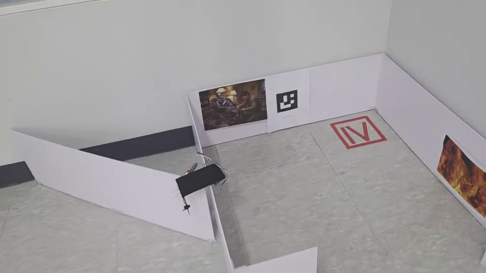
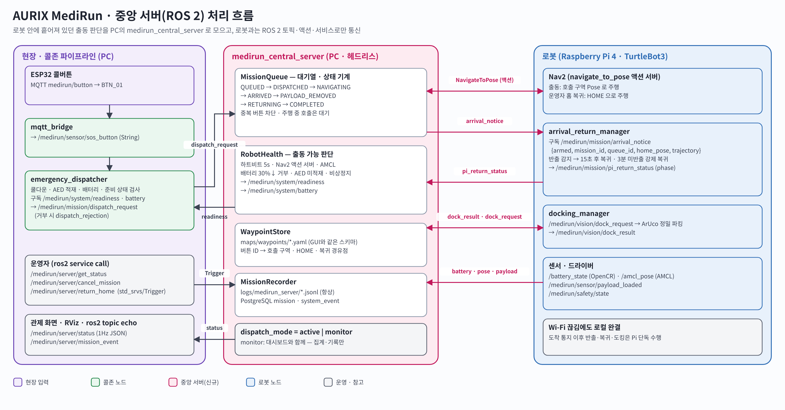
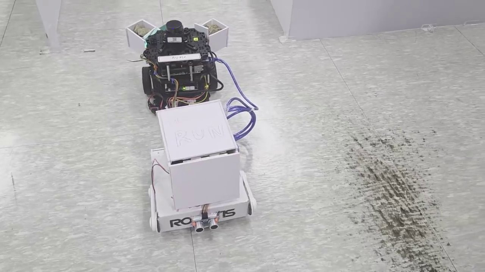
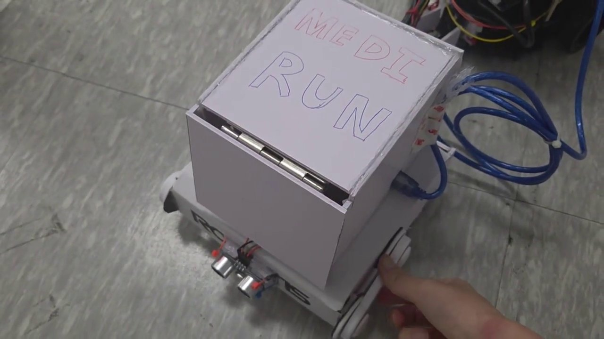

<div align="center">


# AURIX MediRun · 지하철 역사 AED 배송 보조 로봇

### 팀 AURIX · ROS 2 자율주행 로봇 프로젝트

</div>

> **SOS 버튼이 눌린 곳까지 AED를 로봇이 대신 운반합니다.**

<table>
<thead>
<tr><th align="center">로봇 v1 주행</th><th align="center">로봇 v2 주행</th><th align="center">관제 대시보드</th></tr>
</thead>
<tbody><tr><td align="center"></td><td align="center"></td><td align="center"></td></tr></tbody>
<tbody><tr><td align="center"><a href="https://youtu.be/2j3xnAyrCw8">▶ 전체 영상</a></td><td align="center"><a href="https://youtu.be/Zs3RCvMrCqs">▶ 전체 영상</a></td><td align="center"><a href="https://youtu.be/OLHDFCh1oA8">▶ 전체 영상</a></td></tr></tbody>
</table>

---

## 1. 팀 구성 및 역할

<table>
<thead>
<tr>
    <th nowrap>담당자</th>
    <th nowrap>담당 파트</th>
    <th>주요 기여</th>
  </tr>
</thead>
<tbody><tr>
    <td align="center" nowrap>도희정</td>
    <td align="center" nowrap>DB · 대시보드 ·<br>복귀 흐름</td>
    <td>DB 설계(공동)·로그인·로봇 등록, 대시보드 재구성·원격 제어·웨이포인트 관리, 미션 디스패치와 Pi 로컬 복귀(<code>arrival_return_manager</code>), ESP32 콜버튼 펌웨어</td>
  </tr></tbody>
<tbody><tr>
    <td align="center" nowrap>최치언</td>
    <td align="center" nowrap>하드웨어 ·<br>관제 · 주행 안전</td>
    <td>로봇·AED 트레일러 제작과 Arduino 센서 보드, DB 설계(공동), 실시간·미션 관제·SLAM 페이지, 초음파 안전정지·Nav2 튜닝, ArUco 전면주차, 정확도 시험</td>
  </tr></tbody>
</table>


## 2. 프로젝트 주제

환자가 쓰러졌을 때 목격자가 AED를 가지러 자리를 비우면 환자 곁이 비게 되고, 왕복 시간이 초기 대응 시간을 잠식합니다. **MediRun은 AED 운반을 로봇이 대신해서, 사람이 환자 곁에 남아 응급 대응에 집중할 수 있게 하는 이동형 보조 로봇**입니다. TurtleBot3 Burger에 직접 제작한 AED 트레일러를 결합하고, ROS 2 · Nav2 · Arduino 센서 · Qt 관제 대시보드 · PostgreSQL로 구성했습니다.

> MediRun은 AED 운반과 그 기록만 담당합니다. 환자 상태 판단·응급처치·119 자동 신고는 하지 않습니다.

## 3. 주제 선정 이유

심정지 환자에게 AED를 얼마나 빨리 쓰느냐는 생존과 바로 이어집니다. 질병관리청 조사에서 2023년 국내 급성심장정지 환자는 33,586건이었고, 생존율은 8.6%에 머물렀습니다. 같은 조사에서 일반인이 심폐소생술을 한 경우 생존율이 13.2%까지 올라간 것을 보면, 구급대가 도착하기 전 현장에서의 몇 분이 결과를 크게 좌우합니다.

해외에서는 AED를 사람 대신 옮기는 방법이 이미 시험되고 있습니다. 스웨덴 예테보리에서는 구급차 출동과 함께 드론으로 AED를 보냈는데, 비교 가능한 55건 가운데 37건에서 드론이 먼저 도착했고 도착 시간은 중앙값 약 3분 빨라졌습니다.

그러나 지붕과 벽으로 둘러싸인 지하철 역사에서는 드론을 띄우기 어렵고, 지금도 목격자가 직접 AED를 가지러 뛰어가야 합니다. 그동안 환자 곁은 비게 되고, 붐비는 승강장에서 보관함까지 오가는 시간만큼 처치는 늦어집니다. 이러한 한계가 있기 때문에, 사람은 환자 곁을 지키고 AED는 바닥을 달리는 로봇이 가져오는 방식이 필요하다고 보고 이 프로젝트를 진행하게 되었습니다.

**현장에서 마주한 문제**

- **환자 곁이 빈다**: 목격자 한 명이 AED를 가지러 자리를 뜨면, 그사이 심폐소생술을 이어 갈 사람이 줄어듭니다.
- **보관함이 멀다**: AED는 역사 안 정해진 위치에만 있어서, 승강장 끝에서 쓰러지면 왕복 거리부터 길어집니다.
- **드론은 실내에서 쓰기 어렵다**: 천장이 낮고 사람이 많은 역사에서는 바닥을 주행하는 로봇이 더 현실적인 운반 수단입니다.
- **혼잡한 통로**: 출퇴근 시간대에는 길을 비켜 달라는 신호 없이 빠르게 지나가기 힘듭니다.
- **남지 않는 기록**: 언제 어디서 호출이 있었는지 수기로만 남으면, 대응 과정을 나중에 되짚어 보기 어렵습니다.

**최종 목표** — 목격자가 환자 곁을 떠나지 않아도 AED가 도착하고, 사용이 끝나면 로봇이 스스로 제자리로 돌아가 다음 호출에 대비하는 역사 내 응급 보조 체계를 만드는 것입니다.

<sub>출처: [Schierbeck et al., *The Lancet Digital Health* (2023)](https://news.ki.se/drones-enabled-the-use-of-defibrillators-before-ambulance-arrival) · [질병관리청 급성심장정지조사 (2023)](https://www.kdca.go.kr/injury/biz/injury/damgInfo/heartStopMain.do)</sub>

## 4. 운영 환경 및 개발 정보

<table>
<thead>
<tr><th align="left">항목</th><th align="left">내용</th></tr>
</thead>
<tbody><tr><td align="left">적용 대상</td><td align="left">지하철 역사 대합실·승강장 (가상 A역 시연)</td></tr></tbody>
<tbody><tr><td align="left">운용 형태</td><td align="left">단일 로봇 자율 주행, 도착 이후 반출·복귀·도킹은 로봇이 단독 처리</td></tr></tbody>
<tbody><tr><td align="left">호출 구성</td><td align="left">고정 SOS 버튼 ↔ 호출 구역 1:1 매핑</td></tr></tbody>
<tbody><tr><td align="left">개발 기간</td><td align="left">4주 (2026.07.20 ~ 08.14)</td></tr></tbody>
</table>

## 5. 핵심 기능

- **SOS 호출 검증** : 버튼 ID·중복 호출·AED 적재·배터리·위치 추정 상태를 확인하고 출동한다.
- **자율 배송** : Nav2로 주행하고 LiDAR·초음파로 장애물을 피한다.
- **반출 감지** : 홀센서 자석 이탈이 0.5초 유지되면 반출로 확정한다.
- **자동 복귀** : 반출 15초 후, 또는 3분 미반출 시 홈으로 돌아간다.
- **정밀 파킹** : ArUco 마커로 좌우 3cm·각도 5° 이내에 주차한다.
- **관제 · 기록** : Qt 대시보드로 관제하고 전 과정을 PostgreSQL에 남긴다.

## 6. 사용자 요구사항 (User Requirements)

<table>
<thead>
<tr><th align="left">ID</th><th align="left">사용자 요구사항</th></tr>
</thead>
<tbody><tr><td align="left">UR-001</td><td align="left">물리 버튼으로 해당 구역에 로봇을 요청할 수 있어야 한다.</td></tr></tbody>
<tbody><tr><td align="left">UR-002</td><td align="left">버튼 입력 시 구역·좌표·시각이 기록되어야 한다.</td></tr></tbody>
<tbody><tr><td align="left">UR-003</td><td align="left">로봇이 호출 구역에 10cm 이내로 도착해야 한다.</td></tr></tbody>
<tbody><tr><td align="left">UR-004</td><td align="left">출발·도착·정지를 음성과 LED로 알 수 있어야 한다.</td></tr></tbody>
<tbody><tr><td align="left">UR-005</td><td align="left">주행 중 &quot;비켜주세요&quot; 안내를 5초마다 반복해야 한다.</td></tr></tbody>
<tbody><tr><td align="left">UR-006</td><td align="left">주행 중 빨강↔주황 경광 표시로 멀리서도 식별되어야 한다.</td></tr></tbody>
<tbody><tr><td align="left">UR-007</td><td align="left">도착 후 3초 이내에 119 신고 안내를 들을 수 있어야 한다.</td></tr></tbody>
<tbody><tr><td align="left">UR-008</td><td align="left">AED가 실려 있지 않으면 출동을 거부해야 한다.</td></tr></tbody>
<tbody><tr><td align="left">UR-009</td><td align="left">AED를 꺼내면 15초 뒤 로봇이 스스로 돌아가야 한다.</td></tr></tbody>
<tbody><tr><td align="left">UR-010</td><td align="left">지도·위치·배터리·미션·센서·연결 상태를 실시간으로 볼 수 있어야 한다.</td></tr></tbody>
<tbody><tr><td align="left">UR-011</td><td align="left">권한에 맞는 화면과 기능만 사용할 수 있어야 한다.</td></tr></tbody>
<tbody><tr><td align="left">UR-012</td><td align="left">위급 시 대시보드에서 즉시 정지시킬 수 있어야 한다.</td></tr></tbody>
<tbody><tr><td align="left">UR-013</td><td align="left">정지 원인이 사라지면 3초 확인 후 자동 재출발해야 한다.</td></tr></tbody>
<tbody><tr><td align="left">UR-014</td><td align="left">라이다가 못 보는 15cm 이내 낮은 장애물에서 정지·우회해야 한다.</td></tr></tbody>
<tbody><tr><td align="left">UR-015</td><td align="left">주행 중 새 호출을 확인·보류·취소할 수 있어야 한다.</td></tr></tbody>
<tbody><tr><td align="left">UR-016</td><td align="left">이동 실패 시 복귀 여부와 원인을 확인할 수 있어야 한다.</td></tr></tbody>
<tbody><tr><td align="left">UR-017</td><td align="left">배터리 20% 미만이면 임무보다 복귀를 우선해야 한다.</td></tr></tbody>
<tbody><tr><td align="left">UR-018</td><td align="left">호출부터 복귀까지 이력을 <code>mission_id</code>로 조회할 수 있어야 한다.</td></tr></tbody>
<tbody><tr><td align="left">UR-019</td><td align="left">Wi-Fi가 끊겨도 주행 기록이 로봇에 남아야 한다.</td></tr></tbody>
<tbody><tr><td align="left">UR-020</td><td align="left">연결이 끊기면 3초마다 재접속하고 밀린 기록을 올려야 한다.</td></tr></tbody>
<tbody><tr><td align="left">UR-021</td><td align="left">로봇 저장 공간이 포화되지 않도록 기록을 정리해야 한다.</td></tr></tbody>
<tbody><tr><td align="left">UR-022</td><td align="left">대시보드 실행 시 2.5초 내 스플래시 후 로그인 화면이 떠야 한다.</td></tr></tbody>
<tbody><tr><td align="left">UR-023</td><td align="left">복귀 후 도킹 위치에 좌우 3cm·각도 5° 이내로 주차해야 한다.</td></tr></tbody>
<tbody><tr><td align="left">UR-024</td><td align="left">코드 수정 없이 YAML로 버튼·좌표를 바꿀 수 있어야 한다.</td></tr></tbody>
<tbody><tr><td align="left">UR-025</td><td align="left">전원만 넣으면 전체 시스템이 자동 기동해야 한다.</td></tr></tbody>
<tbody><tr><td align="left">UR-026</td><td align="left">시연·복구 시 로봇을 원격 조작할 수 있어야 한다.</td></tr></tbody>
</table>

## 7. 시스템 요구사항 (System Requirements)

<table>
<thead>
<tr><th align="left">ID</th><th align="left">기능</th><th align="left">요구사항</th></tr>
</thead>
<tbody><tr><td align="left">SR-F-001</td><td align="left">호출 수신</td><td align="left"><code>button_id</code>와 시각을 받아 등록 여부를 검증한다.</td></tr></tbody>
<tbody><tr><td align="left">SR-F-002</td><td align="left">목적지 변환</td><td align="left">등록된 이름을 map 기준 Pose로 변환한다.</td></tr></tbody>
<tbody><tr><td align="left">SR-F-003</td><td align="left">Nav2 주행</td><td align="left">Nav2 목표를 보내고 결과·피드백을 처리한다.</td></tr></tbody>
<tbody><tr><td align="left">SR-F-004</td><td align="left">호출 대기열</td><td align="left">진행 중 미션이 있으면 신규 호출을 <code>QUEUED</code>로 둔다.</td></tr></tbody>
<tbody><tr><td align="left">SR-F-005</td><td align="left">음성 안내</td><td align="left">상태별 음성 안내를 로봇 스피커로 출력한다.</td></tr></tbody>
<tbody><tr><td align="left">SR-F-006</td><td align="left">경고 음성</td><td align="left"><code>NAVIGATING</code> 동안 경고 음성을 5초마다 반복한다.</td></tr></tbody>
<tbody><tr><td align="left">SR-F-007</td><td align="left">경광 LED</td><td align="left">주행 중 LED를 빨강↔주황으로 교대 점멸한다.</td></tr></tbody>
<tbody><tr><td align="left">SR-F-008</td><td align="left">119 안내</td><td align="left"><code>ARRIVED</code> 진입 3초 안에 119 안내를 1회 출력한다.</td></tr></tbody>
<tbody><tr><td align="left">SR-F-009</td><td align="left">적재 확인</td><td align="left">홀센서로 AED 적재를 확인하고 미적재 시 거부한다.</td></tr></tbody>
<tbody><tr><td align="left">SR-F-010</td><td align="left">자동 복귀</td><td align="left">반출 15초 후 복귀, 미반출이면 1분마다 안내 후 3분에 복귀한다.</td></tr></tbody>
<tbody><tr><td align="left">SR-F-011</td><td align="left">상태 전달</td><td align="left">위치·배터리·연결·미션·센서 상태를 화면에 전달한다.</td></tr></tbody>
<tbody><tr><td align="left">SR-F-012</td><td align="left">권한</td><td align="left">로그인 역할에 따라 메뉴와 조작을 제한한다.</td></tr></tbody>
<tbody><tr><td align="left">SR-F-013</td><td align="left">급정지</td><td align="left">속도 명령을 차단해 0속도를 유지하고 목표는 보관한다.</td></tr></tbody>
<tbody><tr><td align="left">SR-F-014</td><td align="left">재출발</td><td align="left">조건 충족을 판정하고 보관된 목표로 재개한다.</td></tr></tbody>
<tbody><tr><td align="left">SR-F-015</td><td align="left">저상 장애물</td><td align="left">전방 하단 초음파 임계 거리에서 정지·재계획한다.</td></tr></tbody>
<tbody><tr><td align="left">SR-F-016</td><td align="left">실패 대응</td><td align="left">이동 실패 시 홈 복귀를 시도하고, 실패하면 정지·알람한다.</td></tr></tbody>
<tbody><tr><td align="left">SR-F-017</td><td align="left">배터리 보호</td><td align="left">20% 미만이면 미션을 중단하고 복귀한다.</td></tr></tbody>
<tbody><tr><td align="left">SR-F-018</td><td align="left">로컬 기록</td><td align="left">미션·이벤트·주행 기록을 로봇 DB에 먼저 저장한다.</td></tr></tbody>
<tbody><tr><td align="left">SR-F-019</td><td align="left">재연결</td><td align="left">3초마다 재연결하고 미동기 기록을 시간순으로 올린다.</td></tr></tbody>
<tbody><tr><td align="left">SR-F-020</td><td align="left">기록 정리</td><td align="left">동기화된 기록과 임시 파일을 하루 단위로 정리한다.</td></tr></tbody>
<tbody><tr><td align="left">SR-F-021</td><td align="left">스플래시</td><td align="left">대시보드 기동 시 로고 스플래시를 재생한다.</td></tr></tbody>
<tbody><tr><td align="left">SR-F-022</td><td align="left">정밀 도킹</td><td align="left">ArUco 마커로 정렬·접근·도킹을 판정한다.</td></tr></tbody>
<tbody><tr><td align="left">SR-F-023</td><td align="left">자동 실행</td><td align="left">프로세스 관리자가 전 노드를 부팅 시 기동·재시작한다.</td></tr></tbody>
<tbody><tr><td align="left">SR-F-024</td><td align="left">경로 주행</td><td align="left">버튼별 경로(trajectory)를 중간 정지 없이 주행하고 같은 경로로 복귀한다.</td></tr></tbody>
</table>

<details>
<summary>성능 · 안전 요구사항 보기</summary>

<table>
<thead>
<tr><th align="left">ID</th><th align="left">항목</th><th align="left">기준</th></tr>
</thead>
<tbody><tr><td align="left">SR-P-001</td><td align="left">버튼 응답</td><td align="left">버튼 입력 → 미션 생성 1초 이내 (20회)</td></tr></tbody>
<tbody><tr><td align="left">SR-P-002</td><td align="left">도착 오차</td><td align="left">평균 3cm 이하, 최대 5cm 이하</td></tr></tbody>
<tbody><tr><td align="left">SR-P-003</td><td align="left">직진 오차</td><td align="left">1m 직진 평균 1cm 이하 (10회)</td></tr></tbody>
<tbody><tr><td align="left">SR-P-004</td><td align="left">회전 오차</td><td align="left">90°·180° 평균 2° 이하 (각 10회)</td></tr></tbody>
<tbody><tr><td align="left">SR-P-006</td><td align="left">급정지</td><td align="left">GUI 입력 → 0속도 0.5초 이내</td></tr></tbody>
<tbody><tr><td align="left">SR-P-008</td><td align="left">저상 장애물</td><td align="left">15cm 진입 → 정지 0.3초 이내, 충돌 0건</td></tr></tbody>
<tbody><tr><td align="left">SR-P-010</td><td align="left">단절 감지</td><td align="left">heartbeat 차단 → 판정 2초 이내</td></tr></tbody>
<tbody><tr><td align="left">SR-P-012</td><td align="left">도킹 정밀도</td><td align="left">좌우 3cm·각도 5° 이하, 10회 중 8회 성공</td></tr></tbody>
<tbody><tr><td align="left">SR-P-013</td><td align="left">반복 신뢰성</td><td align="left">전체 시나리오 10회 중 8회 성공 (연속 3회 포함)</td></tr></tbody>
<tbody><tr><td align="left">SR-S-001</td><td align="left">속도 제한</td><td align="left">최대 0.05m/s · 0.7rad/s (도킹 최종 접근 0.03m/s)</td></tr></tbody>
<tbody><tr><td align="left">SR-S-004</td><td align="left">우선순위</td><td align="left">비상정지 &gt; 배터리 복귀 &gt; 자율주행 &gt; 원격 제어</td></tr></tbody>
<tbody><tr><td align="left">SR-S-006</td><td align="left">미션 보존</td><td align="left">급정지는 목표를 취소하지 않고 속도만 차단</td></tr></tbody>
</table>

</details>

## 8. 시스템 아키텍처

### 하드웨어 아키텍처


### 소프트웨어 아키텍처


## 9. 하드웨어 구성

<table>
<thead>
<tr><th align="left">구분</th><th align="left">구성</th></tr>
</thead>
<tbody><tr><td align="left">주행 플랫폼</td><td align="left">TurtleBot3 Burger (OpenCR 1.0, Dynamixel XL430 ×2)</td></tr></tbody>
<tbody><tr><td align="left">메인 컴퓨터</td><td align="left">Raspberry Pi 4 · Ubuntu 22.04 · ROS 2 Humble</td></tr></tbody>
<tbody><tr><td align="left">센서</td><td align="left">LDS-02 LiDAR, IMX219 카메라</td></tr></tbody>
<tbody><tr><td align="left">센서 보드</td><td align="left">Arduino — 초음파 전·후방, 홀센서, RGB 경광 LED</td></tr></tbody>
<tbody><tr><td align="left">AED 트레일러</td><td align="left">직접 제작, AED 수납함 + 자석, 하부 볼 캐스터(v2)</td></tr></tbody>
<tbody><tr><td align="left">호출 장치</td><td align="left">ESP32 Wi-Fi 콜버튼 (MQTT)</td></tr></tbody>
</table>

<table>
<tbody><tr>
    <td align="center" width="33%"></td>
    <td align="center" width="33%"></td>
    <td align="center" width="33%"></td>
  </tr></tbody>
<tbody><tr>
    <td align="center">v0 · 박스 트레일러 시험</td>
    <td align="center">v1 · 첫 번째 제작</td>
    <td align="center">v2 · 볼 캐스터 보강</td>
  </tr></tbody>
</table>


> 유선 SOS 버튼 입력(A1~A3)은 A1을 홀센서가 쓰고 있어 비활성입니다. 호출은 ESP32 콜버튼으로만 받습니다.

## 10. 운영 시나리오

### Scenario #1 - SOS 호출과 AED 배송

1. 목격자 한 명은 119에 신고하고, 다른 한 명은 가장 가까운 SOS 버튼을 누른다.
2. ESP32가 `BTN_01`을 MQTT로 보내고, `emergency_dispatcher`가 출동 조건을 확인한다.
3. 로봇이 경광 LED와 "비켜주세요" 안내를 내며 호출 구역으로 주행한다.
4. 도착하면 AED 도착과 119 신고 안내를 출력한다.

### Scenario #2 - AED 반출과 자동 복귀

1. 사람이 수납함에서 AED를 꺼내면 홀센서가 0.5초 뒤 반출을 확정한다.
2. 15초 후 "홈으로 복귀합니다" 안내와 함께 경로를 따라 돌아간다.
3. 도킹 대기점에서 ArUco 마커를 찾아 정밀 주차한다.
4. 전 과정이 `mission_id` 기준으로 기록되고 다음 호출을 기다린다.

### Scenario #3 - 주행 중 예외 상황

1. 주행 중 새 호출이 오면 대기열에 넣고 현재 미션을 먼저 끝낸다.
2. 목표 도달에 실패하면 최대 2회 다시 계획하고, 실패하면 `FAILED`로 기록한다.
3. 배터리 30% 미만이면 신규 출동을 거부하고 20% 미만이면 바로 복귀한다.
4. AED가 실려 있지 않으면 출동을 거부하고 경고를 낸다.

### Scenario #4 - 미반출과 Wi-Fi 단절

1. AED를 꺼내지 않으면 1분마다 반출을 안내한다.
2. 3분이 지나면 AED를 실은 채 홈으로 돌아간다.
3. 도착 이후 단계는 Pi가 단독으로 처리해 Wi-Fi가 끊겨도 멈추지 않는다.
4. 끊긴 동안의 이벤트는 저장해 두었다가 다시 연결되면 순서대로 올린다.

<table>
<tbody><tr>
    <td align="center" width="25%"></td>
    <td align="center" width="25%"></td>
    <td align="center" width="25%"></td>
    <td align="center" width="25%"></td>
  </tr></tbody>
<tbody><tr>
    <td align="center">① 콜버튼 호출</td>
    <td align="center">② 자율 주행</td>
    <td align="center">③ AED 반출</td>
    <td align="center">④ 정밀 파킹</td>
  </tr></tbody>
</table>

## 11. 시퀀스 다이어그램

각 시나리오에서 노드 사이에 오가는 메시지 순서입니다.

### Scenario #1 - SOS 호출과 AED 배송


### Scenario #2 - AED 반출과 자동 복귀


### Scenario #3 - 주행 중 예외 상황


## 12. 중앙 서버 (ROS 2)

출동 판단을 대시보드 밖으로 빼서, PC의 ROS 2 노드 `medirun_central_server`가 맡도록 했습니다.

- **호출 대기열** : 같은 버튼 중복 호출을 막고, 주행 중 호출은 순서대로 처리한다.
- **출동 판단** : 배터리·위치·AED 적재·Nav2 상태로 출동 가능 여부를 정한다.
- **도착 통지** : 도착하면 Pi에 복귀 정보를 넘기고, 반출·복귀는 Pi가 처리한다.
- **기록** : 미션 상태 변화를 JSONL과 PostgreSQL에 남긴다.
- **운영 명령** : `get_status` · `cancel_mission` · `return_home` 서비스를 제공한다.

<table>
<thead>
<tr><th align="left">실행 모드</th><th align="left">설명</th></tr>
</thead>
<tbody><tr><td align="left"><code>active</code></td><td align="left">대시보드 없이 서버가 출동을 맡는다. 대시보드와 동시에 쓰지 않는다.</td></tr></tbody>
<tbody><tr><td align="left"><code>monitor</code></td><td align="left">대시보드가 출동하고, 서버는 상태 집계와 기록만 한다.</td></tr></tbody>
</table>



> 시험 33건을 통과했습니다. 실제 로봇과의 연동 주행 시험은 아직 진행하지 않았습니다.

## 13. 구현 결과

<table>
<thead>
<tr><th align="left">시험</th><th align="left">항목</th><th align="left">결과</th><th align="left">기준</th><th align="left">판정</th></tr>
</thead>
<tbody><tr><td align="left">T-00</td><td align="left">90° 회전 10회</td><td align="left">평균 오차 0.13°</td><td align="left">2° 이하</td><td align="left">충족</td></tr></tbody>
<tbody><tr><td align="left">T-01</td><td align="left">0.45m 직진 10회</td><td align="left">평균 오차 0.2cm</td><td align="left">1cm 이하</td><td align="left">충족</td></tr></tbody>
</table>

<table>
<tbody><tr>
    <td align="center" width="25%"></td>
    <td align="center" width="25%"></td>
    <td align="center" width="25%"></td>
    <td align="center" width="25%"></td>
  </tr></tbody>
<tbody><tr>
    <td align="center">T-00 회전 정확도 시험</td>
    <td align="center">대기 · AED 적재</td>
    <td align="center">도착 · AED 수납함</td>
    <td align="center">반출 후 자동 복귀</td>
  </tr></tbody>
</table>

- **시험 원본** : [`docs/tests/`](docs/tests)
- **트러블슈팅** : [`docs/troubleshooting/`](docs/troubleshooting) (통신 · DB · GUI · 하드웨어 · 주행 · SLAM)
- **자동 시험** : `medirun_mission` 115건, `medirun_server` 33건 통과

## 14. 소스 구성

<table>
<thead>
<tr><th align="left">경로</th><th align="left">역할</th></tr>
</thead>
<tbody><tr><td align="left"><a href="src/medirun_server"><code>src/medirun_server/</code></a></td><td align="left">중앙 서버 — 호출 대기열·출동·상태 집계·기록</td></tr></tbody>
<tbody><tr><td align="left"><a href="src/medirun_mission"><code>src/medirun_mission/</code></a></td><td align="left">출동 검증·미션 관리·Pi 로컬 복귀·안전 관리</td></tr></tbody>
<tbody><tr><td align="left"><a href="src/medirun_sensor"><code>src/medirun_sensor/</code></a></td><td align="left">Arduino 시리얼 브리지·MQTT 브리지</td></tr></tbody>
<tbody><tr><td align="left"><a href="src/medirun_vision"><code>src/medirun_vision/</code></a></td><td align="left">ArUco 검출·정밀 도킹</td></tr></tbody>
<tbody><tr><td align="left"><a href="src/medirun_gui"><code>src/medirun_gui/</code></a></td><td align="left">Qt6 관제 대시보드</td></tr></tbody>
<tbody><tr><td align="left"><a href="src/medirun_bringup"><code>src/medirun_bringup/</code></a></td><td align="left">Pi·PC·콜존 실행 launch</td></tr></tbody>
<tbody><tr><td align="left"><a href="firmware"><code>firmware/</code></a></td><td align="left">Arduino · ESP32 펌웨어</td></tr></tbody>
<tbody><tr><td align="left"><a href="db"><code>db/</code></a></td><td align="left">PostgreSQL 스키마 · 마이그레이션</td></tr></tbody>
<tbody><tr><td align="left"><a href="docs"><code>docs/</code></a></td><td align="left">설계서 00~06 · 시험 · 트러블슈팅 · 이미지</td></tr></tbody>
</table>

## 15. 프로젝트 기술 스택

<table>
<thead>
<tr><th align="left">구분</th><th align="left">사용 기술</th></tr>
</thead>
<tbody><tr><td align="left">Robot / Hardware</td><td align="left">TurtleBot3 Burger, Raspberry Pi 4, OpenCR 1.0, LDS-02, IMX219, Arduino, ESP32</td></tr></tbody>
<tbody><tr><td align="left">Robot Middleware</td><td align="left">ROS 2 Humble, Nav2, AMCL, Cartographer, CycloneDDS</td></tr></tbody>
<tbody><tr><td align="left">Vision</td><td align="left">OpenCV ArUco</td></tr></tbody>
<tbody><tr><td align="left">Server / Data</td><td align="left">Python, PostgreSQL 16, Docker Compose, MQTT(mosquitto)</td></tr></tbody>
<tbody><tr><td align="left">GUI</td><td align="left">Qt6 (C++)</td></tr></tbody>
<tbody><tr><td align="left">운영 · 협업</td><td align="left">PM2 · systemd 자동 실행, Git 훅 기반 커밋 규칙, GitHub</td></tr></tbody>
</table>

## 16. 설치와 실행

```bash
git clone https://github.com/postwo/AURIX_MEDIRUN-PROJECT1.git
cd AURIX_MEDIRUN-PROJECT1
source /opt/ros/humble/setup.bash
colcon build --symlink-install --packages-skip medirun_msgs
source install/setup.bash
```

<table>
<thead>
<tr><th align="left">장비</th><th align="left">실행 명령</th></tr>
</thead>
<tbody><tr><td align="left">DB</td><td align="left"><code>cp .env.example .env</code> 후 <code>docker compose up -d</code></td></tr></tbody>
<tbody><tr><td align="left">로봇 (Pi)</td><td align="left"><code>ros2 launch medirun_bringup pi_bringup.launch.py</code></td></tr></tbody>
<tbody><tr><td align="left">관제 PC (대시보드)</td><td align="left"><code>./scripts/run.sh</code></td></tr></tbody>
<tbody><tr><td align="left">관제 PC (중앙 서버)</td><td align="left"><code>./scripts/run_server.sh</code> (대시보드와 함께면 <code>MEDIRUN_SERVER_MODE=monitor</code>)</td></tr></tbody>
</table>

자세한 절차는 [개발 환경 · 빌드 · 실행 가이드](docs/WORKSPACE_GUIDE.md)를 참고하세요.

## 17. 문서

<table>
<thead>
<tr><th align="left">문서</th><th align="left">내용</th></tr>
</thead>
<tbody><tr><td align="left"><a href="docs/AURIX_MediRun_00_%ED%94%84%EB%A1%9C%EC%A0%9D%ED%8A%B8_%EA%B0%9C%EC%9A%94%EC%84%9C.pdf">00 프로젝트 개요서</a></td><td align="left">추진 배경 · 시스템 구성 · 성공 기준</td></tr></tbody>
<tbody><tr><td align="left"><a href="docs/AURIX_MediRun_01_%EC%84%9C%EB%B9%84%EC%8A%A4_%EC%8B%9C%EB%82%98%EB%A6%AC%EC%98%A4%EC%84%9C.pdf">01 서비스 시나리오서</a></td><td align="left">정상 · 예외 시나리오 (S-01 ~ S-12)</td></tr></tbody>
<tbody><tr><td align="left"><a href="docs/AURIX_MediRun_02_%EC%9A%94%EA%B5%AC%EC%82%AC%ED%95%AD_%EC%84%A4%EA%B3%84_%EC%8B%9C%ED%97%98%EC%9D%B8%EC%88%98_%EC%9C%84%ED%97%98%EA%B4%80%EB%A6%AC.pdf">02 요구사항 · 설계 · 시험</a></td><td align="left">UR · SR · 시험 계획 · 위험 관리</td></tr></tbody>
<tbody><tr><td align="left"><a href="docs/AURIX_MediRun_03_GUI_HMI_%EC%84%A4%EA%B3%84_Qt_CPP_%EC%B5%9C%EC%A2%85%EC%99%84%EB%A3%8C%EB%B3%B8.pdf">03 GUI · HMI 설계</a></td><td align="left">Qt 대시보드 설계</td></tr></tbody>
<tbody><tr><td align="left"><a href="docs/AURIX_MediRun_04_ROS2_%EC%86%8C%ED%94%84%ED%8A%B8%EC%9B%A8%EC%96%B4_%EC%84%A4%EA%B3%84.pdf">04 ROS 2 소프트웨어 설계</a></td><td align="left">노드 · 토픽 · 상태 머신</td></tr></tbody>
<tbody><tr><td align="left"><a href="docs/AURIX_MediRun_05_%EC%8B%9C%EC%8A%A4%ED%85%9C_%EC%95%84%ED%82%A4%ED%85%8D%EC%B2%98_%EA%B5%AC%EC%A1%B0%EB%8F%84.pdf">05 시스템 아키텍처</a></td><td align="left">데이터 흐름 · 안전 제어</td></tr></tbody>
<tbody><tr><td align="left"><a href="docs/AURIX_MediRun_06_%EA%B0%9C%EB%B0%9C_%EA%B7%9C%EC%B9%99%EC%84%9C.pdf">06 개발 규칙서</a></td><td align="left">Git · 네이밍 규칙</td></tr></tbody>
</table>

---

**팀 AURIX**
