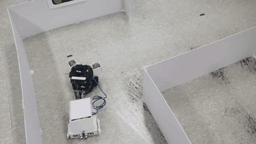
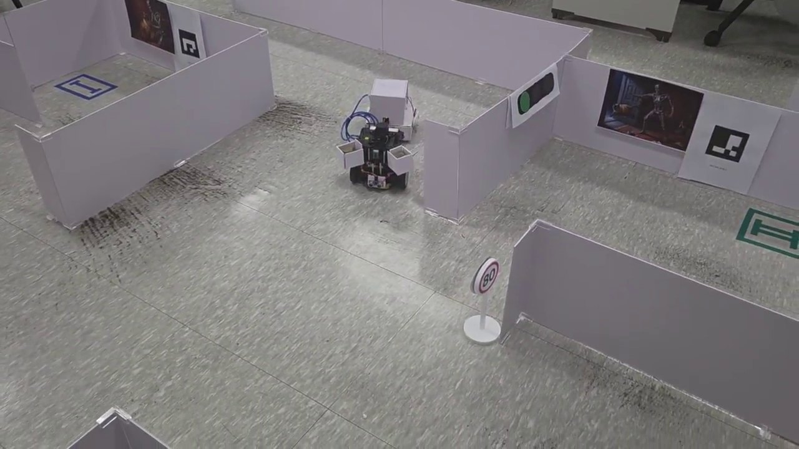
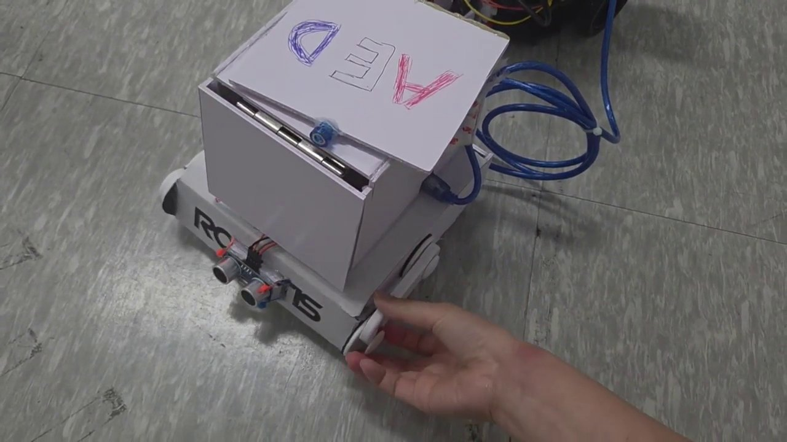
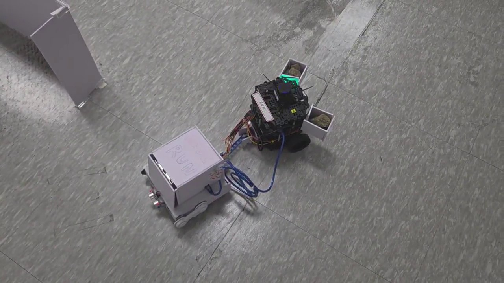
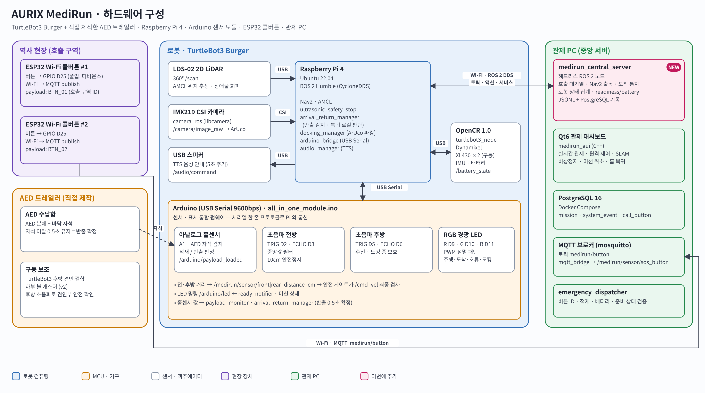
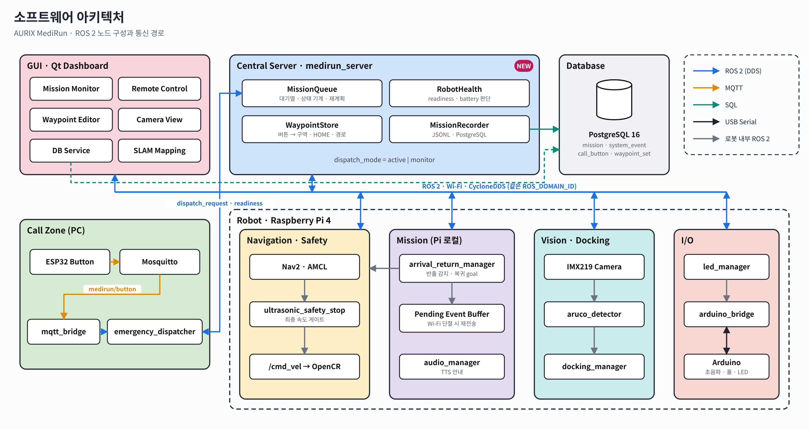
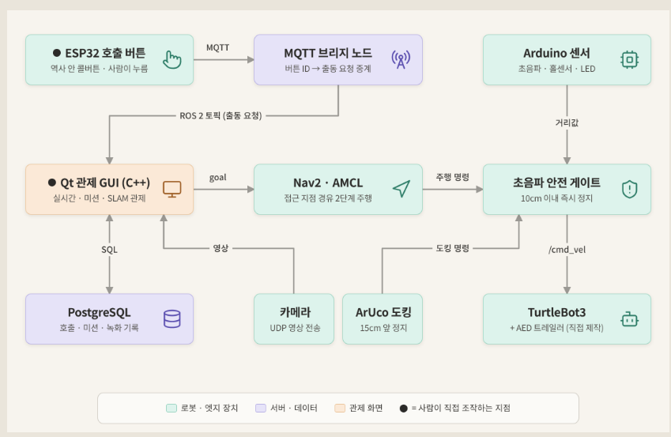
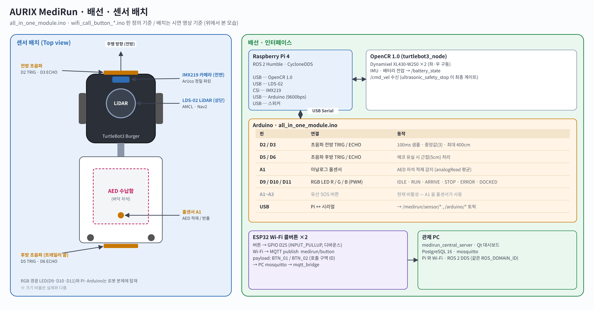
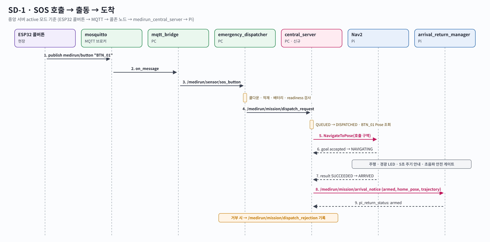

<div align="center">


# AURIX MediRun · 지하철 역사 AED 배송 보조 로봇

### 팀 AURIX · ROS 2 자율주행 로봇 프로젝트

**프로젝트 기간: 2026.07.20 ~ 2026.08.14 (4주)**

</div>

> SOS 버튼이 눌린 구역까지 AED를 자율 주행으로 운반하고, 반출 후 스스로 복귀·파킹하며, 전 과정을 기록합니다.

환자가 쓰러졌을 때 목격자가 AED를 가지러 자리를 비우면 환자 곁이 비게 되고, 왕복 시간이 초기 대응 시간을 잠식합니다. **MediRun은 AED 운반을 로봇이 대신해서, 사람이 환자 곁에 남아 응급 대응에 집중할 수 있게 하는 이동형 보조 로봇**입니다. TurtleBot3 Burger에 직접 제작한 AED 트레일러를 결합하고, ROS 2 Humble · Nav2 · Arduino 센서 · Qt 관제 대시보드 · PostgreSQL로 구성했습니다.

### 시연 영상

| 로봇 v1 주행 | 로봇 v2 주행 | 관제 대시보드 |
| :--: | :--: | :--: |
|  |  |  |
| [▶ v1 전체 영상](https://youtu.be/2j3xnAyrCw8) | [▶ v2 전체 영상](https://youtu.be/Zs3RCvMrCqs) | [▶ 대시보드 전체 영상](https://youtu.be/OLHDFCh1oA8) |

---

<details>
<summary><b>프로젝트 목차</b></summary>

1. [프로젝트 개요](#1-프로젝트-개요)
2. [팀 구성](#2-팀-구성)
3. [운영 시나리오](#3-운영-시나리오)
4. [사용자 요구사항 (User Requirements)](#4-사용자-요구사항-user-requirements)
5. [시스템 요구사항 (System Requirements)](#5-시스템-요구사항-system-requirements)
6. [시스템 아키텍처](#6-시스템-아키텍처)
7. [하드웨어 구성 및 제작](#7-하드웨어-구성-및-제작)
8. [중앙 서버 (ROS 2)](#8-중앙-서버-ros-2)
9. [미션 상태 흐름과 안전 제어](#9-미션-상태-흐름과-안전-제어)
10. [시퀀스 다이어그램](#10-시퀀스-다이어그램)
11. [관제 대시보드 (Qt / C++)](#11-관제-대시보드-qt--c)
12. [구현 결과와 검증](#12-구현-결과와-검증)
13. [현재 한계와 확장 목표](#13-현재-한계와-확장-목표)
14. [소스 구성](#14-소스-구성)
15. [프로젝트 기술 스택](#15-프로젝트-기술-스택)
16. [설치와 실행](#16-설치와-실행)
17. [문서](#17-문서)

</details>

---

## 1. 프로젝트 개요

### 기획 배경 · 주제 선정 이유

| 배경 | 내용 |
| :-- | :-- |
| 현장 인력 이탈 | 목격자가 AED를 가지러 이동하면 환자 곁이 비게 된다. 로봇이 운반을 대신하면 사람은 환자에 집중할 수 있다. |
| AED 접근 거리 | 역사 내 AED 보관함은 승강장에서 떨어져 있는 경우가 많아, 왕복 시간이 초기 대응 시간을 잠식한다. |
| 혼잡한 통행 환경 | 퇴근 시간대 역사는 보행자 밀도가 높다. 경광 LED와 반복 음성으로 주행 경로 확보를 돕는다. |
| 대응 기록 부재 | 호출 구역과 시각이 수기로 남으면 사후 검토가 어렵다. 전 과정을 `mission_id` 기준으로 자동 기록한다. |

### 문제 정의

- 누가 어디서 호출했는지(버튼 ID → 구역 → map 좌표)를 즉시 확정하고, 그 구역까지 **사람 없이** AED를 가져가야 한다.
- 주행 중 보행자·저상 장애물·배터리·위치 유실 같은 예외가 생겨도 **안전정지 › 배터리 보호 › AED 배송 › 자동 복귀 › 원격 제어** 순으로 판단해야 한다.
- AED를 꺼낸 뒤에는 로봇이 스스로 돌아와 정확한 위치에 다시 주차해야 다음 호출을 받을 수 있다.

### 개발 목표

- **호출 → 출동**: 고정 SOS 버튼 3개 ↔ 목적지 3개를 1:1로 매핑하고, 버튼 입력부터 미션 생성까지 1초 이내
- **자율 배송**: Nav2 자율 주행, LiDAR·초음파 장애물 회피, 목표 오차 10cm 이내 도착
- **반출 · 복귀**: 홀센서로 AED 반출을 0.5초 유지 시 확정 → 15초 후 자동 복귀, 미반출 3분이면 강제 복귀
- **정밀 파킹**: 도킹 대기점에서 ArUco 마커 정렬로 좌우 3cm · 각도 5° 이내 파킹
- **관제 · 기록**: Qt 대시보드 실시간 관제·원격 제어, 호출부터 복귀까지 PostgreSQL 기록
- **중앙 서버(추가)**: 출동 판단을 PC의 헤드리스 ROS 2 노드로 모아, 대시보드 없이도 호출 대기열·출동·기록을 처리

> **수행 범위 제한**: MediRun은 AED 운반과 그 기록만 담당합니다. 환자 상태 판단, 응급처치 판단, 119 자동 신고는 하지 않으며 119 신고는 현장의 사람이 직접 합니다.

| 항목 | 내용 |
| :-- | :-- |
| 적용 대상 | 지하철 역사 대합실·승강장 (가상 A역 기준 시연) |
| 운용 형태 | 단일 로봇 자율 주행, 도착 이후 반출·복귀·도킹은 로봇 내부에서 완결 |
| 호출 구성 | 고정 SOS 버튼 3개 ↔ 최종 목적지 3개, 1:1 매핑 |
| 플랫폼 | TurtleBot3 Burger + 직접 제작한 AED 트레일러, Raspberry Pi 4 |

---

## 2. 팀 구성

| 담당자 | 담당 파트 | 주요 기여 |
| :---: | :---: | :-- |
| **도희정**<br>`dev-learning1` | DB · 대시보드 기반<br>웨이포인트 · 복귀 흐름<br>센서 시험 코드 | • PostgreSQL 스키마 1차 설계 (최치언과 공동), Docker 실행 환경, 로그인·계정·로봇 등록<br>• 웨이포인트·경로·홈을 `waypoint_set`에 저장하는 구조 설계, `call_button`을 콜존 웨이포인트 기준으로 연동<br>• 주행 시 `robot_session`·`nav_goal_log`·`user_action_log` 자동 기록<br>• 와이어프레임 기반 대시보드 전면 재구성, 운영 현황 실데이터 연동<br>• 원격 제어 페이지 (카메라 라이브·지도 실시간 위치·텔레옵·센서 상태 패널)<br>• 웨이포인트·경로 관리 페이지 (Nav2 연동, 초기 위치·속도, DB CRUD)<br>• 웨이포인트·미션 디스패치 파이프라인과 콜존 브링업, PC 전용 launch<br>• `arrival_return_manager` 연동 — Pi 로컬 반출 감지·자동 복귀, Wi-Fi 단절 시 로컬 버퍼링·재전송<br>• 출동·복귀 trajectory 연속 주행, 복귀 중 장애물 음성 경고<br>• ESP32 Wi-Fi 콜버튼 펌웨어·MQTT 브릿지, 초음파·홀센서·LED·SOS 버튼 모듈 벤치 테스트 |
| **최치언**<br>`postwo` | **하드웨어**<br>관제 대시보드<br>주행 · 안전<br>비전 · 시험<br>DB 설계(공동) | • **로봇 하드웨어 담당** — TurtleBot3 + AED 트레일러 제작(v1 → v2 하부 볼 캐스터), Arduino 센서 보드(초음파 전·후방·홀센서·RGB LED) 구성<br>• PostgreSQL 스키마 1차 설계 (도희정과 공동)<br>• 실시간 관제 페이지 (녹화 일시정지·스냅샷, 단계 표시기, 이벤트 스트림, CAM·배터리 배지)<br>• 미션 관제 페이지 (대기 호출 큐, 24시간 처리 이력, 미션 취소·대기 호출 처리 흐름)<br>• SLAM 매핑 페이지 (카메라 오버레이, 수동 텔레옵), 스플래시 화면, 긴급 정지 버튼<br>• 로봇 조종 권한(리더 선출)과 다중 창 동기화, GUI 구조를 역할별 클래스로 분리<br>• 초음파 근접 안전정지 노드·센서 끊김 워치독, Nav2 회복 동작이 안전 게이트를 우회하던 배선 수정<br>• 홀센서 핀 분리·풀업, 시리얼 브리지 재연결·파싱 안정화, ESP32 호출 → 미션 디스패치 중계<br>• ArUco 마커 기반 홈 전면주차, 트레일러 정렬용 2단계 접근 주행<br>• Nav2 파라미터 튜닝 (도착 정밀도·회전 오실레이션·회복 동작), 목표 취소 보강<br>• 직선·회전 정확도 시험 (T-00 · T-01), 브링업 모니터 노드<br>• 주행 녹화 세션 자동 기록, TIMESTAMPTZ·KST 정리, 카메라 CycloneDDS UDP 전송 |

> 커밋 이력(`git log`)의 작성자별 `feat`/`fix` 커밋을 기준으로 정리했습니다. 설계서(00~06)와 1차 DB 설계는 두 사람이 함께 했고, 브랜치·커밋 규칙은 [COMMIT_RULES.md](COMMIT_RULES.md)를 따릅니다.

---

## 3. 운영 시나리오

### Scenario 1 · SOS 호출 → AED 배송 → 자동 복귀 (S-01)

1. 전원 인가 → 자동 실행 → 초기 위치 설정 → AED 적재 확인 → LED 초록, "시스템 준비 완료" 안내
2. 목격자 한 명은 119에 신고하고, 다른 목격자는 가장 가까운 MediRun SOS 버튼을 누른다.
3. 버튼 ID가 ESP32 → MQTT로 전달되고 `emergency_dispatcher`가 버튼 ID·중복 호출·배터리·AMCL·AED 적재를 검사한다.
4. 출동 미션이 Nav2 목표로 전송된다. 주행 중 LED는 빨강↔주황 경광 모드, "긴급상황 발생, 비켜주세요"를 5초 주기로 반복한다.
5. LiDAR/Nav2로 장애물을 회피하고, 초음파가 저상 장애물을 감지하면 감속·정지·재계획한다.
6. 호출 구역 10cm 이내 도착 → LED 주황 점멸 → AED 도착과 119 신고·위치 전달 안내
7. 홀센서가 자석 이탈을 0.5초 이상 감지하면 반출을 확정하고 15초 후 복귀한다.
8. 홈 웨이포인트 → 도킹 대기점 → ArUco 정렬·파킹 → IDLE(LED 초록)

<table>
  <tr>
    <td width="25%" align="center"></td>
    <td width="25%" align="center"></td>
    <td width="25%" align="center"></td>
    <td width="25%" align="center"></td>
  </tr>
  <tr>
    <td align="center">① 대기 · AED 적재</td>
    <td align="center">② 호출 구역 벽면 콜버튼</td>
    <td align="center">③ 역사 모형 자율 주행</td>
    <td align="center">④ 도착 · AED 수납함</td>
  </tr>
  <tr>
    <td align="center"></td>
    <td align="center"></td>
    <td align="center"></td>
    <td align="center"></td>
  </tr>
  <tr>
    <td align="center">⑤ AED 반출 (수납함 개봉)</td>
    <td align="center">⑥ 자동 복귀</td>
    <td align="center">⑦ ArUco 마커 정밀 파킹</td>
    <td align="center">v2 로봇 (트레일러 결합)</td>
  </tr>
</table>

> 장면은 [`ppt/시연 영상.mp4`](ppt) 에서 캡처했습니다.

### Scenario 2 · 주행 중 중복 호출 / 목표 도달 실패 (S-02, S-04)

1. 진행 중 미션이 있으면 신규 호출은 `QUEUED`로 대기열에 등록되고 대시보드에 표시된다.
2. 같은 버튼의 호출이 이미 대기·진행 중이면 중복으로 무시한다.
3. 목표 도달에 실패하면 비용지도 초기화 후 최대 2회 재계획하고, 그래도 실패하면 `FAILED`로 기록한다.
4. 현재 미션이 끝나면 대기열의 다음 호출을 꺼내 출동한다.

### Scenario 3 · 도착 후 AED 미반출 / Wi-Fi 단절 (S-12, S-05)

1. 도착 후 AED를 꺼내지 않으면 1분마다 "AED를 반출해 주세요"를 안내한다.
2. 3분이 지나면 AED를 실은 채 홈으로 자동 복귀한다.
3. 도착 통지 이후의 반출 감지·타이머·복귀 goal·도킹은 Pi의 `arrival_return_manager`가 로컬로 수행하므로 Wi-Fi가 끊겨도 복귀가 멈추지 않는다.
4. 그 사이의 단계 이벤트는 Pi에 버퍼링했다가 PC가 다시 붙으면 순서대로 재전송한다.

<details>
<summary><b>예외 시나리오 전체 (S-02 ~ S-12)</b></summary>

| ID | 상황 | 시스템 처리 | 종료 기준 |
| :-- | :-- | :-- | :-- |
| S-02 | 주행 중 중복 호출 | 기존 미션 유지, 신규 호출은 QUEUED 등록 및 대시보드 표시 | 현재 미션 완료 후 처리·취소 |
| S-03 | GUI 비상정지 | 속도 명령 차단·0속도 유지, 목표 Pose 보관, LED 빨강 상시 | 조건 충족 후 재개 또는 취소 |
| S-04 | 목표 도달 실패 | 정지 → 비용지도 초기화 → 재계획 → 최대 2회 재시도 | 성공 또는 FAILED |
| S-05 | Wi-Fi·대시보드 단절 | 자율 임무와 로컬 기록 유지, 3초 주기 재연결 | 재연결 후 현재 상태 갱신 |
| S-06 | 배터리 부족 | 30% 미만 신규 미션 거부, 20% 미만 즉시 복귀, 10% 미만 안전정지 | 충전 및 관리자 확인 |
| S-07 | 알 수 없는 버튼 ID | 호출 거부, 원본 ID·오류 저장, LED 빨강 1회 점멸 | 설정 수정 후 재시험 |
| S-08 | 하단 장애물 15cm 이내 | 즉시 감속·정지, 지역 비용지도 반영 후 우회 경로 재계획 | 장애물 이탈 또는 우회 성공 |
| S-09 | ArUco 마커 5초 미검출 | 0.2m 후퇴 후 재탐색, 최대 3회 재시도 | 도킹 성공 또는 실패 기록 |
| S-10 | AED 미적재 호출 | 미션 거부, 경고 음성·LED 빨강·대시보드 경고 | AED 적재 후 재호출 |
| S-11 | 이동 실패(FAILED) | 홈 복귀 우선 시도. 복귀 불가·위치 유실이면 현재 위치 정지와 알람 | 관리자 회수·복구 |
| S-12 | 도착 후 AED 미반출 | 1분마다 안내하고 3분 후 AED를 실은 채 자동 복귀 | AED 반출 또는 홈 도착 → IDLE |

출처: [01 서비스 시나리오서](docs/AURIX_MediRun_01_서비스_시나리오서.pdf)

</details>

---

## 4. 사용자 요구사항 (User Requirements)

<details>
<summary><b>UR-001 ~ UR-026 펼쳐 보기</b></summary>

| ID | 명칭 | 사용자 | 요구사항 | 인수 조건 |
| :-- | :-- | :-- | :-- | :-- |
| UR-001 | 현장 SOS 호출 | 호출자 | 물리 버튼으로 해당 구역에 로봇을 요청한다 | 버튼 3개가 각각 지정 구역 미션 생성 |
| UR-002 | 응급 위치 기록 | 호출자 | 버튼 입력 시 구역·좌표·시각이 기록된다 | event_id·button_id·구역·map 좌표·시각 저장 |
| UR-003 | 호출 위치 이동 | 호출자 | 로봇이 호출 구역으로 이동한다 | 목표 오차 10cm 이내 도착 |
| UR-004 | 출동·도착 알림 | 호출자 | 출발·도착·정지를 음성과 LED로 확인한다 | 상태별 지정 음성·LED 출력 |
| UR-005 | 주행 중 경고 안내 | 보행자 | 주행 중 로봇이 비켜 달라는 안내를 한다 | '비켜주세요. 긴급상황입니다.' 5초 주기 반복 |
| UR-006 | 경광 표시 | 보행자 | 주행 중인 로봇을 멀리서도 식별한다 | 주행 중 빨강↔주황 교대 점멸 |
| UR-007 | 119 신고 안내 | 호출자 | 도착 시 119 신고를 음성으로 안내받는다 | 도착 후 3초 이내 안내 음성 출력 |
| UR-008 | AED 적재 확인 | 역무원 | 출동 전 AED 적재 여부를 확인한다 | 미적재 시 미션 거부 및 경고 |
| UR-009 | 반출 자동 복귀 | 호출자 | AED를 꺼내면 로봇이 스스로 돌아간다 | 반출 감지 15초 후 복귀 시작 |
| UR-010 | 실시간 관제 | 역무원 | 지도·위치·배터리·미션·센서·연결 상태를 본다 | 갱신 주기 충족 |
| UR-011 | 역할별 화면 | 어드민/역무원 | 권한에 맞는 화면과 기능만 사용한다 | 역할별 메뉴·조작 권한 분리 |
| UR-012 | 비상정지 | 역무원 | 위급 시 대시보드에서 즉시 정지시킨다 | 0속도 유지, 상태 전환, 미션 보관 |
| UR-013 | 자동 재출발 | 역무원 | 급정지 원인이 사라지면 로봇이 스스로 재출발한다 | 조건 충족 후 3초 유지 시 자동 재개 |
| UR-014 | 하단 장애물 회피 | 현장 | 라이다가 보지 못하는 낮은 장애물에 걸리지 않는다 | 15cm 이내 감지 시 정지·우회 |
| UR-015 | 동시 호출 처리 | 역무원 | 주행 중 새 호출을 확인·보류·취소한다 | 큐와 결정 이력 표시 |
| UR-016 | 실패 대응 | 역무원 | 이동 실패 시 복귀 여부와 원인을 확인한다 | 복귀 시도 또는 정지 알람 발생 |
| UR-017 | 배터리 보호 | 관리자 | 배터리가 부족하면 임무보다 복귀를 우선한다 | 20% 미만 시 즉시 복귀 전환 |
| UR-018 | 미션 로그 | 관리자 | 호출부터 복귀까지 이력을 조회한다 | mission_id 기준 이벤트 연결 |
| UR-019 | 단절 시 기록 유지 | 관리자 | Wi-Fi가 끊겨도 주행 기록이 남는다 | 단절 구간 기록이 로봇 DB에 100% 저장 |
| UR-020 | 자동 재연결·동기화 | 관리자 | 연결이 끊기면 자동으로 재접속하고 밀린 기록을 올린다 | 3초 주기 재시도, 복구 시 자동 동기화 |
| UR-021 | 로그 보관 관리 | 어드민 | 로봇 내부 저장 공간이 포화되지 않는다 | 동기화 완료 기록 1일 주기 자동 정리 |
| UR-022 | 대시보드 인트로 | 운영자 | 대시보드 실행 시 로고 애니메이션을 본다 | 2.5초 내 스플래시 후 로그인 화면 |
| UR-023 | ArUco 정밀 파킹 | 어드민 | 복귀 후 지정 도킹 위치에 정밀 주차한다 | 마커 기준 좌우 3cm·각도 5° 이내 |
| UR-024 | 설정 변경 | 어드민 | 코드 수정 없이 버튼·좌표를 바꾼다 | YAML 변경 후 재기동만으로 반영 |
| UR-025 | 자동 실행 | 관리자 | 전원 인가만으로 전체 시스템이 기동한다 | SSH 명령 없이 부팅 후 임무 대기 진입 |
| UR-026 | 원격 수동 제어 | 어드민 | 시연·복구 시 로봇을 원격 조작한다 | 자율 목표 취소 후 수동 제어 |

출처: [02 요구사항·설계·시험·인수·위험관리](docs/AURIX_MediRun_02_요구사항_설계_시험인수_위험관리.pdf) 2장

</details>

---

## 5. 시스템 요구사항 (System Requirements)

<details>
<summary><b>기능(SR-F) · 성능(SR-P) · 안전(SR-S) 요구사항 펼쳐 보기</b></summary>

**기능 요구사항**

| ID | 상위 UR | 시스템 요구사항 | 검증 |
| :-- | :-- | :-- | :-- |
| SR-F-001 | UR-001 | button_id와 시각을 수신하고 등록 여부를 검증한다 | 시험 |
| SR-F-002 | UR-003/024 | 등록된 이름을 map 기준 Pose로 변환한다 | 시험 |
| SR-F-003 | UR-003 | Nav2 목표를 전송하고 결과·피드백을 처리한다 | 통합 시험 |
| SR-F-004 | UR-015 | 활성 미션이 있으면 신규 호출을 QUEUED로 둔다 | 시험 |
| SR-F-005 | UR-004/005/007 | 상태별 음성 안내를 로봇 스피커로 출력한다 | 시연 |
| SR-F-006 | UR-005 | NAVIGATING 동안 경고 음성을 5초 주기로 반복한다 | 시연 |
| SR-F-007 | UR-006 | 주행 중 LED를 빨강↔주황 교대 점멸로 구동한다 | 시연 |
| SR-F-008 | UR-007 | ARRIVED 진입 3초 이내 119 안내 음성을 1회 출력한다 | 시연 |
| SR-F-009 | UR-008 | 홀센서로 AED 적재를 확인하고 미적재 시 미션을 거부한다 | 시험 |
| SR-F-010 | UR-009 | AED 반출 감지 후 15초 뒤 홈 복귀. 미반출 시 1분 주기 안내 후 3분 경과하면 AED를 실은 채 복귀 | 시험 |
| SR-F-011 | UR-010/011 | 위치·배터리·연결·미션·센서 상태를 역할별 화면에 전달한다 | 통합 시험 |
| SR-F-012 | UR-011 | 로그인 역할에 따라 조작 권한과 메뉴를 제한한다 | 시험 |
| SR-F-013 | UR-012 | 급정지 시 속도 명령을 차단해 0속도를 유지하고, 미션 ID와 목표 Pose는 보관한다 | 안전 시험 |
| SR-F-014 | UR-013 | 재출발 조건 충족을 판정하고 보관된 목표로 미션을 재개한다 | 안전 시험 |
| SR-F-015 | UR-014 | 전방 하단 초음파 임계 거리에서 정지하고 우회 경로를 재계획한다 | 안전 시험 |
| SR-F-016 | UR-016 | 이동 실패 시 홈 복귀를 시도하고, 실패 시 정지 후 알람을 발생한다 | 시험 |
| SR-F-017 | UR-017 | 배터리 20% 미만이면 진행 중 미션을 중단하고 복귀로 전환한다 | 시험 |
| SR-F-018 | UR-018/019 | 미션·이벤트·주행 기록을 로봇 내부 DB에 먼저 저장한다 | 사용 |
| SR-F-019 | UR-020 | 연결 단절 감지 후 3초 주기로 재연결하고, 복구 시 미동기 기록을 시간순으로 동기화한다 | 시험 |
| SR-F-020 | UR-021 | 동기화 완료 기록과 임시 파일을 1일 주기로 정리한다 | 사용 |
| SR-F-021 | UR-022 | 대시보드 기동 시 로고 스플래시를 재생한다 | 시연 |
| SR-F-022 | UR-023 | ArUco 마커 기반 정렬·접근·도킹 판정을 수행한다 | 시험 |
| SR-F-023 | UR-025 | 프로세스 관리자가 전 노드를 부팅 시 자동 기동·재시작한다 | 시험 |
| SR-F-024 | UR-003 | 버튼에 지정된 경로(trajectory)가 있으면 저장 순서대로 중간 정지 없이 주행하고, 복귀 시에도 같은 경로로 HOME까지 연속 주행한다 | 통합 시험 |

**성능 요구사항** (배터리 50% 이상, 동일 바닥재, 0.05m/s, 동일 지도·초기 Pose)

| ID | 항목 | 측정 | 기준 |
| :-- | :-- | :-- | :-- |
| SR-P-001 | 버튼 응답 | 버튼 입력 ↔ 미션 생성 이벤트 시각 차, 20회 | 전 회차 1초 이내 |
| SR-P-002 | 목표 도착 오차 | 목표 Pose ↔ 정지 후 AMCL Pose | 평균 ≤ 3cm, 최대 ≤ 5cm |
| SR-P-003 | 직진 이동 오차 | 1m 직진 후 줄자 실측, 10회 | 평균 ≤ 1cm, 최대 ≤ 2cm |
| SR-P-004 | 회전 오차 | 90°·180° 명령 후 각도자 실측, 각 10회 | 평균 ≤ 2°, 최대 ≤ 4° |
| SR-P-005 | 왕복 반복도 | 두 지점 왕복 10회 후 시작점 복귀 오차 | 평균 ≤ 5cm, 최대 ≤ 8cm |
| SR-P-006 | 급정지 처리 | GUI 입력 ↔ 첫 0속도 발행, 10회 | 전 회차 0.5초 이내 |
| SR-P-007 | 자동 재출발 | 조건 충족 ↔ 주행 재개, 10회 | 3초 유지 확인 후 5초 이내 |
| SR-P-008 | 하단 장애물 | 15cm 진입부터 정지까지 | 전 회차 0.3초 이내, 충돌 0건 |
| SR-P-009 | 관제 갱신 주기 | 대시보드 수신 로그 평균 주기 | 미션·안전 2Hz 이상, 위치 5Hz 이상 |
| SR-P-010 | 통신 단절 감지 | heartbeat 차단 ↔ 단절 판정, 10회 | 전 회차 2초 이내 |
| SR-P-011 | 기록 동기화 | 이벤트 발생 ↔ 통합 DB 반영 | 연결 정상 시 평균 2초 이내 |
| SR-P-012 | 도킹 정밀도 | 마커 기준 좌우·각도 오차, 10회 | 좌우 ≤ 3cm, 각도 ≤ 5°, 성공 8회 이상 |
| SR-P-013 | 반복 신뢰성 | 전체 시나리오 E2E 10회 | 성공 8회 이상, 연속 3회 포함, 치명 오류 0건 |

**안전 요구사항**

| ID | 항목 | 내용 |
| :-- | :-- | :-- |
| SR-S-001 | 속도 | 최대 선속도 0.05m/s, 최대 각속도 0.7rad/s (도킹 최종 접근 0.03m/s) |
| SR-S-002 | 장애물 | 안전거리 내 장애물에 정지 또는 충돌 없는 재경로 |
| SR-S-003 | 하단 사각지대 | 전방 하단 초음파 15cm 이내 감지 시 정지·우회 |
| SR-S-004 | 우선순위 | 비상정지 > 배터리 보호 복귀 > 자율주행 > 원격 제어 |
| SR-S-005 | 재출발 | 명시 조건 전부 충족 시에만 자동 재출발 |
| SR-S-006 | 미션 보존 | 급정지는 목표를 취소하지 않고 속도만 차단한다 |

</details>

---

## 6. 시스템 아키텍처

### 하드웨어 아키텍처

<p align="center">
  
</p>

### 소프트웨어 아키텍처

<p align="center">
  
</p>

<details>
<summary><b>기존 시스템 구성도</b></summary>

<p align="center">
  
</p>

</details>

- **현장 입력**: 역사 안 ESP32 콜버튼이 MQTT로 호출을 보내면 `mqtt_bridge`가 버튼 ID를 ROS 2 토픽으로 바꾸고, `emergency_dispatcher`가 출동 조건을 검사합니다.
- **로봇(Raspberry Pi 4 + TurtleBot3)**: 아두이노 센서(초음파·홀센서·LED)를 USB Serial로 받고, Nav2·AMCL이 주행하며, 초음파 안전 게이트와 `safety_manager`가 모든 속도 명령을 마지막으로 검사한 뒤 `/cmd_vel`을 내보냅니다.
- **관제 PC**: Qt 대시보드가 미션·SLAM 상태를 관제하고, 새로 추가한 **중앙 서버(`medirun_central_server`)** 가 호출 대기열·출동·로봇 상태 집계·기록을 ROS 2로 처리합니다. 기록은 PostgreSQL에 남습니다.
- **로컬 독립성**: 도착 통지 이후의 반출 감지·복귀·도킹은 Pi 혼자 수행하므로 Wi-Fi나 PC가 끊겨도 복귀가 멈추지 않습니다.

<details>
<summary><b>노드 책임 분리</b></summary>

| 계층 | 노드 | 역할 |
| :-- | :-- | :-- |
| 중앙 서버 | `medirun_central_server` | 호출 대기열·출동(Nav2 goal)·도착 통지·로봇 상태 집계·기록 (PC, 신규) |
| 서비스 응용 | `emergency_dispatcher` | 버튼 ID·안전 조건 검증, 미션 요청 생성 (Nav2를 직접 제어하지 않음) |
| | `waypoint_manager` | YAML 목적지·경로 조회와 Pose 검증 |
| | `mission_manager` | 상태 전이, Nav2 액션, 재시도·복귀 관리 |
| | `arrival_return_manager` | 도착 이후 반출 감지·타이머·복귀 goal (Pi 로컬) |
| 안전·적재 | `safety_manager` | 모든 속도 명령보다 높은 우선순위로 최종 검사, 위험 시 0속도 |
| | `payload_monitor` | 홀센서 기반 AED 적재·반출 확정 |
| 주행·도킹 | Nav2 · AMCL · TF | 경로 계획·재계획, map 기준 위치 추정 |
| | `docking_manager` | ArUco 정렬·접근·도킹 재시도 |
| 입출력 | `arduino_bridge` · `mqtt_bridge` | 버튼·초음파·홀센서·LED 시리얼 연결, ESP32 MQTT 수신 |
| 기록·실행 | `event_logger` · PostgreSQL · PM2 | 미션 ID 기준 이벤트 저장, 부팅 시 자동 실행·장애 시 재시작 |

</details>

---

## 7. 하드웨어 구성 및 제작

| 구분 | 구성 | 역할 |
| :-- | :-- | :-- |
| 주행 플랫폼 | TurtleBot3 Burger (OpenCR 1.0, Dynamixel XL430 ×2) | 차동 구동, IMU·배터리 상태 |
| 메인 컴퓨터 | Raspberry Pi 4 · Ubuntu 22.04 · ROS 2 Humble | Nav2·AMCL·안전 게이트·복귀·도킹 |
| 센서 | LDS-02 2D LiDAR, IMX219 CSI 카메라 | 위치 추정·장애물 회피, ArUco 도킹 |
| 센서 보드 | Arduino (`all_in_one_module.ino`, USB Serial 9600bps) | 초음파 전·후방(D2/D3, D5/D6), 홀센서(A1), RGB 경광 LED(D9~D11) |
| AED 트레일러 | 직접 제작, AED 수납함 + 자석, 하부 볼 캐스터(v2) | AED 운반, 홀센서로 반출 감지 |
| 호출 장치 | ESP32 Wi-Fi 콜버튼 (GPIO D25, MQTT `medirun/button`) | 버튼 ID(BTN_01~) 전송 |
| 관제 PC | Ubuntu · Qt6 대시보드 · 중앙 서버 · PostgreSQL · mosquitto | 관제·출동·기록 |

> `all_in_one_module.ino`에는 유선 SOS 버튼 입력(A1~A3)도 정의돼 있지만, A1을 홀센서가 쓰고 있어 현재 비활성입니다. 실제 호출은 ESP32 Wi-Fi 콜버튼으로만 들어옵니다.

### 배선 · 센서 배치

<p align="center">
  
</p>

### 제작 과정 · v0 트레일러 모형

<table>
  <tr>
    <td width="50%" align="center"></td>
    <td width="50%" align="center"></td>
  </tr>
  <tr>
    <td align="center">v0 · ROBOTIS 박스로 만든 트레일러 견인 시험</td>
    <td align="center">최종 · AED 수납함과 후방 초음파</td>
  </tr>
</table>

### 로봇 v1

<table>
  <tr>
    <td width="50%" align="center"></td>
    <td width="50%" align="center"></td>
  </tr>
  <tr>
    <td align="center">v1 내부 배선</td>
    <td align="center">v1 외관</td>
  </tr>
</table>

### 로봇 v2 (트레일러 하부 볼 캐스터 추가)

<table>
  <tr>
    <td width="33%" align="center"></td>
    <td width="33%" align="center"></td>
    <td width="33%" align="center"></td>
  </tr>
  <tr>
    <td align="center">v2 주행</td>
    <td align="center">v2 주행</td>
    <td align="center">하부 볼 캐스터 클로즈업</td>
  </tr>
</table>

<details>
<summary><b>아두이노 센서 모듈 사진</b></summary>

| 초음파 모듈 | 아날로그 홀센서 | 버튼 모듈 | LED 모듈 |
| :--: | :--: | :--: | :--: |
|  |  |  |  |

펌웨어: [`firmware/`](firmware) (all_in_one · hall · led · sos_button · ultrasonic · wifi_call_button_01/02)

</details>

---

## 8. 중앙 서버 (ROS 2)

<p align="center">
  
</p>

기존에는 호출 대기열·출동 goal 전송·도착 통지가 **Qt 대시보드 안(`MissionController`)** 에 있어서 대시보드를 켜 두지 않으면 버튼을 눌러도 로봇이 움직이지 않았고, `/medirun/system/readiness`·`/medirun/system/battery`는 아무도 발행하지 않아 `emergency_dispatcher`의 배터리·준비 상태 검사가 항상 통과했습니다. 이 판단들을 PC의 헤드리스 ROS 2 노드 **`medirun_central_server`** ([`src/medirun_server`](src/medirun_server))로 모았습니다. 로봇과는 ROS 2 토픽·액션·서비스로만 통신하며, 로봇 쪽 노드는 수정하지 않았습니다.

| 구성 | 하는 일 |
| :-- | :-- |
| `MissionQueue` | 호출 대기열·상태 기계 (`QUEUED → DISPATCHED → NAVIGATING → ARRIVED → PAYLOAD_REMOVED → RETURNING → COMPLETED`), 같은 버튼 중복 호출 차단, 주행 중 호출은 대기, 실패 시 최대 2회 재계획 |
| `RobotHealth` | `/battery_state`·`/amcl_pose`·적재 센서·안전 상태·Nav2 액션 서버 유무로 출동 가능 여부 판단 → `/medirun/system/readiness`, `/medirun/system/battery` 발행 |
| `WaypointStore` | `maps/waypoints/*.yaml`(대시보드와 같은 스키마)에서 버튼 → 호출 구역, HOME, 복귀 경유점(trajectory) 조회 |
| `MissionRecorder` | 날짜별 JSONL(항상) + PostgreSQL `mission`·`system_event`(`config/db.yaml`이 있을 때) |

| 인터페이스 | 종류 | 설명 |
| :-- | :-- | :-- |
| `/medirun/mission/dispatch_request` | 구독 | `emergency_dispatcher`의 출동 요청 |
| `navigate_to_pose` | 액션 | 호출 구역 출동 · 운영자 홈 복귀 |
| `/medirun/mission/arrival_notice` | 발행 | 도착 시 Pi에 `{armed, mission_id, queue_id, home_pose, trajectory}` 전달 → 반출·복귀는 Pi가 로컬 처리 |
| `/medirun/mission/pi_return_status`, `/medirun/vision/dock_result` | 구독 | 반출·복귀·도킹 결과로 미션 종료 |
| `/medirun/server/status`, `/medirun/server/mission_event` | 발행 | 1Hz 상태 스냅샷(JSON), 미션 전이 이벤트 |
| `/medirun/server/get_status` · `cancel_mission` · `return_home` | 서비스 | `std_srvs/Trigger` 운영자 명령 |

**운용 모드**

- `active` (`server_bringup.launch.py`): 서버가 출동을 맡습니다. 대시보드의 `MissionController`도 같은 요청에 goal을 보내므로 **대시보드(pc_bringup)와 동시에 쓰지 않습니다.**
- `monitor` (`server_monitor.launch.py`): 대시보드가 출동을 계속 맡고, 서버는 상태 집계·기록·서비스만 제공합니다. 대시보드와 같이 띄워도 충돌하지 않습니다.

```bash
ros2 service call /medirun/server/get_status std_srvs/srv/Trigger
ros2 topic echo /medirun/server/status
```

> 검증 범위: 단위·노드 시험 33건(가짜 rclpy로 토픽 이름·JSON 형식·재시도·취소·복귀·monitor 모드 확인)을 통과했습니다. 실제 로봇(Pi)과의 연동 주행 시험은 아직 진행하지 않았습니다.

---

## 9. 미션 상태 흐름과 안전 제어

```
IDLE → VALIDATING → DISPATCHED → NAVIGATING → ARRIVED → PAYLOAD_REMOVED → RETURNING_HOME → DOCKING → DOCKED → IDLE
```

**판단 우선순위: 안전정지 › 배터리 보호 › AED 배송 › 자동 복귀 › 원격 제어**

| 상황 | 처리 |
| :-- | :-- |
| GUI 비상정지 | 즉시 0속도, 안전 조건을 충족하기 전까지 재출발 금지 |
| 낮은 장애물 | 초음파 감지 시 감속·정지 후 Nav2 재계획 |
| 주행 중 중복 호출 | 기존 미션 유지, 신규 호출은 대기열에 등록 |
| 목표 도달 실패 | 비용지도 초기화 후 최대 2회 재계획, 실패 시 기록 |
| 배터리 부족 | 30% 미만 신규 미션 거부, 20% 미만 즉시 복귀, 10% 미만 안전정지 |
| ArUco 미검출 | 0.2m 후퇴 후 재탐색, 최대 3회 재시도 |
| AMCL 위치 유실 | 현재 위치 정지, 신규 목표 차단, 관리자 확인 요청 |
| AED 미적재 호출 | 미션 거부, 경고 음성·LED·대시보드 경고 |

> 위 수치는 설계서 기준이며, 초음파 정지 거리처럼 시험 중 조정된 값은 launch 파라미터에서 관리합니다(예: 실기에서는 ArUco 전면 주차를 위해 10cm).

---

## 10. 시퀀스 다이어그램

<details open>
<summary><b>SD-1 · SOS 호출 → 출동 → 도착</b></summary>

<p align="center"></p>

</details>

<details>
<summary><b>SD-2 · AED 반출 → 자동 복귀 → 정밀 파킹</b></summary>

<p align="center"></p>

</details>

<details>
<summary><b>SD-3 · 예외 처리 (출동 보류 · 중복 호출 · 재계획 · 운영자 명령)</b></summary>

<p align="center"></p>

</details>

---

## 11. 관제 대시보드 (Qt / C++)

관제사가 로봇 상태와 미션을 한 화면에서 확인하고, 필요하면 비상정지·미션 취소·홈 복귀·원격 조종을 내릴 수 있는 Qt(C++) 대시보드입니다. 대시보드가 끊겨도 도착 이후의 반출·복귀는 로봇 안에서 계속 수행됩니다.

<p align="center">
  
</p>

| 화면 | 주요 기능 |
| :-- | :-- |
| 운영 현황 | 연결 로봇·진행 미션·오늘 호출·안전 이벤트 요약, 시스템 헬스(ROS 2·Nav2·DB·카메라) |
| 실시간 관제 | 지도 위 로봇 위치, 카메라 영상, 배터리·AED 적재·전후방 장애물, 녹화·스냅샷·미션 취소·홈 복귀 |
| 미션 관제 | 대기 호출 큐, 진행 중 미션, 24시간 처리 이력, 재시도·홈 복귀·미션 취소 |
| 원격 제어 | 방향 버튼·WASD 수동 조종, 속도 프리셋, 센서 상태, 도킹 재시도·자율 복귀 |
| 웨이포인트 관리 | 지도 위에서 호출 구역·경유점·홈 위치 등록, 좌표·방향 편집 |
| 이벤트 · 로봇 · 사용자 관리 | `system_event` 조회, 로봇 등록, 계정·권한(ADMIN/STAFF/USER) 관리 |

[▶ 대시보드 운영 영상 전체 보기](https://youtu.be/OLHDFCh1oA8)

---

## 12. 구현 결과와 검증

### 12.1 주행 정확도 시험

| 시험 ID | 항목 | 결과(절대평균오차) | 기준 | 판정 |
| :-- | :-- | :-- | :-- | :-- |
| T-00 | 회전 정확도 (90°, 10회) | 0.13° | ≤ 2° | 충족 |
| T-01 | 직진 정확도 (0.45m, 10회) | 0.2cm | ≤ 1cm | 충족 |

<p align="center">
  
</p>
<p align="center">T-00 회전 정확도 시험 — 각도자 위에서 90° 회전 후 실측</p>

시험 원본: [`docs/tests/`](docs/tests)

### 12.2 성공 판정 기준

버튼당 3회 반복 매핑 성공 · 일반 목적지 오차 10cm 이내 · 도킹 오차 3cm 이내 · 전체 시나리오 E2E 10회 중 8회 이상 성공(연속 3회 포함)

### 12.3 자동 시험

| 패키지 | 내용 | 결과 |
| :-- | :-- | :-- |
| `medirun_mission` | dispatcher·mission_manager·arrival_return_manager·waypoint_manager 등 | 115 passed |
| `medirun_server` | 대기열·상태 기계·웨이포인트·상태 판단·중앙 서버 노드 | 33 passed |

```bash
cd src/medirun_mission && python3 -m pytest -q test
cd src/medirun_server && python3 -m pytest -q test
```

### 12.4 트러블슈팅 기록

분야별 문제·원인·해결: [`docs/troubleshooting/`](docs/troubleshooting) (COMM · DB · GUI · HW · INFRA · NAV · SIM · SLAM)

---

## 13. 현재 한계와 확장 목표

| 현재 한계 | 확장 목표 |
| :-- | :-- |
| 단일 로봇 기준 (대기열이 로봇 1대를 전제) | 중앙 서버 `RobotHealth`를 로봇별로 늘려 준비된 로봇에 배정 |
| 중앙 서버 active 모드와 대시보드 출동 로직을 동시에 쓸 수 없음 | 대시보드 `MissionController`가 서버 서비스를 호출하도록 일원화 |
| 중앙 서버는 실기 연동 시험 전 | Pi와의 E2E 10회 시험(SR-P-013)으로 검증 |
| 119 신고는 사람이 직접 | 역무실 관제 연동 알림 |
| 가상 A역 기준 실내 시연 | 실제 역사 규모 지도·다중 호출 구역 |

---

## 14. 소스 구성

```text
AURIX_MEDIRUN-PROJECT1/
├── src/
│   ├── medirun_server/        # ★ 중앙 서버(ROS 2): 대기열·출동·상태 집계·기록
│   ├── medirun_mission/       # dispatcher, mission/waypoint/arrival_return manager, safety
│   ├── medirun_navigation/    # Nav2 연동
│   ├── medirun_sensor/        # arduino_bridge, mqtt_bridge, sos_bridge
│   ├── medirun_vision/        # ArUco 검출 · docking_manager
│   ├── medirun_db/            # event_logger
│   ├── medirun_gui/           # Qt6 관제 대시보드 (C++)
│   ├── medirun_bringup/       # pi_bringup / pc_bringup / callzone launch
│   ├── medirun_msgs/ · robot_audio_interfaces/
│   └── turtlebot3/ · turtlebot3_msgs/   # 벤더링
├── turtlebot/                 # Pi 쪽 arduino_bridge 워크스페이스 · systemd
├── firmware/                  # Arduino · ESP32 펌웨어
├── maps/                      # 지도 · waypoints/*.yaml
├── db/                        # PostgreSQL 스키마 · 마이그레이션
├── config/                    # db.yaml / device.yaml 예시
├── scripts/                   # run.sh · run_server.sh · run_gui.sh …
└── docs/                      # 설계서 00~06, 시험, 트러블슈팅, 이미지
```

---

## 15. 프로젝트 기술 스택

### Robot & Middleware
<p>
  
  
  
  
  
  
</p>

### Embedded & Sensors
<p>
  
  
  
  
</p>

### Backend · GUI · Data
<p>
  
  
  
  
  
</p>

### Integration & Validation
<p>
  
  
  
  
</p>

---

## 16. 설치와 실행

### 16.1 저장소 받기 · 빌드

```bash
git clone https://github.com/postwo/AURIX_MEDIRUN-PROJECT1.git
cd AURIX_MEDIRUN-PROJECT1
./scripts/setup-git-hooks.sh        # Git 훅 활성화 (clone 직후 1회)
source /opt/ros/humble/setup.bash
colcon build --symlink-install --packages-skip medirun_msgs
source install/setup.bash
```

### 16.2 장비별 준비

| 장비 | 실행 | 먼저 준비할 항목 |
| :-- | :-- | :-- |
| 로봇 (Pi 4) | `ros2 launch medirun_bringup pi_bringup.launch.py` | `TURTLEBOT3_MODEL=burger`, `LDS_MODEL`, 지도 YAML, arduino_bridge 워크스페이스 |
| 관제 PC (대시보드) | `./scripts/run.sh` 또는 `ros2 launch medirun_bringup pc_bringup.launch.py` | Qt6, `config/db.yaml`, `docker compose up -d` (PostgreSQL) |
| 관제 PC (중앙 서버) | `./scripts/run_server.sh` | `maps/waypoints/*.yaml`(버튼·HOME), 같은 `ROS_DOMAIN_ID`·CycloneDDS |

### 16.3 통합 실행 순서

1. DB: `cp .env.example .env` 후 값 입력 → `docker compose up -d`
2. 로봇: Pi에서 `pi_bringup.launch.py` 실행 (Nav2 로컬라이제이션 + 안전 게이트 + 복귀 매니저)
3. PC: 아래 중 하나를 선택

```bash
# A) 대시보드로 출동 (기존 방식) + 중앙 서버는 관제 보조
./scripts/run.sh
MEDIRUN_SERVER_MODE=monitor ./scripts/run_server.sh
```

```bash
# B) 대시보드 없이 중앙 서버가 출동 (헤드리스)
./scripts/run_server.sh
```

DB 설정, Pi 쪽 실행, 카메라, 시험 실행 등 자세한 절차는 [개발 환경·빌드·실행 가이드](docs/WORKSPACE_GUIDE.md)를 참고하세요.

---

## 17. 문서

| 문서 | 내용 |
| :-- | :-- |
| [00 프로젝트 개요서](docs/AURIX_MediRun_00_프로젝트_개요서.pdf) | 추진 배경, 시스템 구성, 서비스 흐름, 운영 원칙, 성공 기준 |
| [01 서비스 시나리오서](docs/AURIX_MediRun_01_서비스_시나리오서.pdf) | 정상·예외 시나리오(S-01~S-12), 상태 전이 |
| [02 요구사항·설계·시험·인수·위험관리](docs/AURIX_MediRun_02_요구사항_설계_시험인수_위험관리.pdf) | 사용자·시스템 요구사항, Nav2·안전·도킹 설계, 시험 계획 |
| [03 GUI·HMI 설계](docs/AURIX_MediRun_03_GUI_HMI_설계_Qt_CPP_최종완료본.pdf) | Qt(C++) 대시보드 설계 |
| [04 ROS 2 소프트웨어 설계](docs/AURIX_MediRun_04_ROS2_소프트웨어_설계.pdf) | 노드·토픽·서비스·액션, 상태 머신, 로그 설계 |
| [05 시스템 아키텍처 구조도](docs/AURIX_MediRun_05_시스템_아키텍처_구조도.pdf) | 데이터 흐름, 안전 제어, 확장성 |
| [06 개발 규칙서](docs/AURIX_MediRun_06_개발_규칙서.pdf) | Git 작업 규칙, 네이밍·구조 규칙 |
| [개발 환경·빌드·실행 가이드](docs/WORKSPACE_GUIDE.md) | 워크스페이스 구성, 빌드·실행 절차, 시험 방법 |
| [COMMIT_RULES](COMMIT_RULES.md) · [CONVENTIONS](CONVENTIONS.md) | 브랜치·커밋 규칙, 네이밍·구조 컨벤션 |

<br/>

<div align="center"><b>팀 AURIX</b></div>
