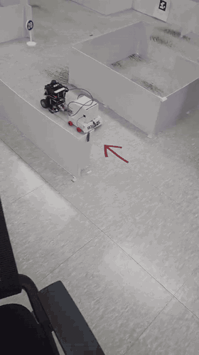
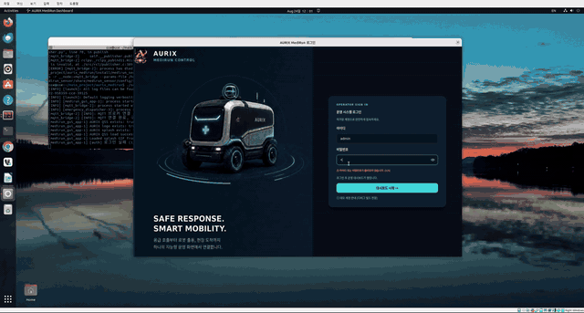
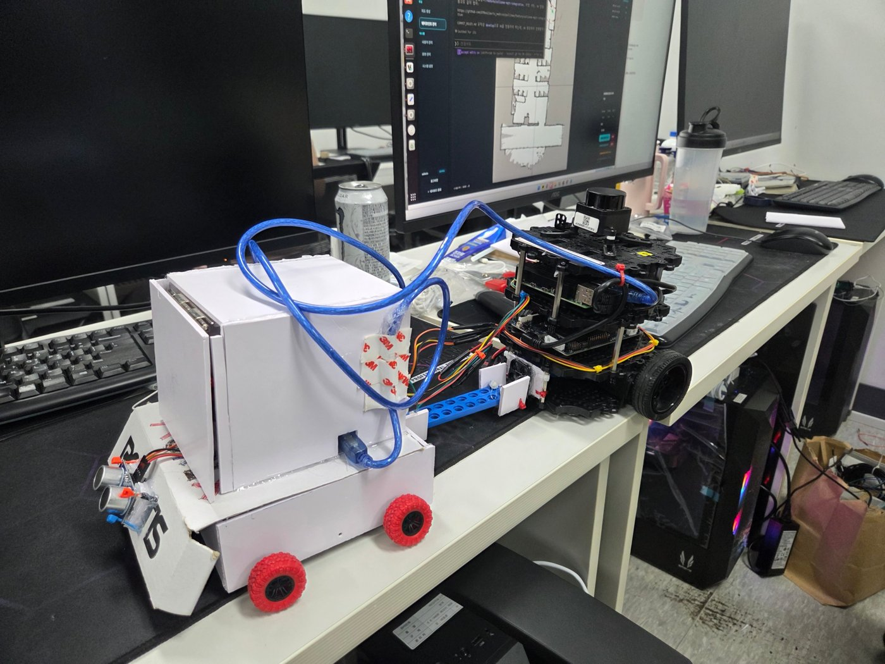
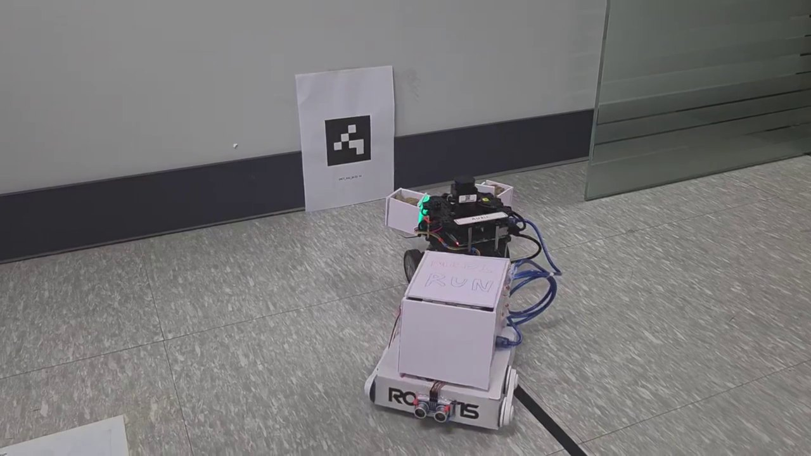
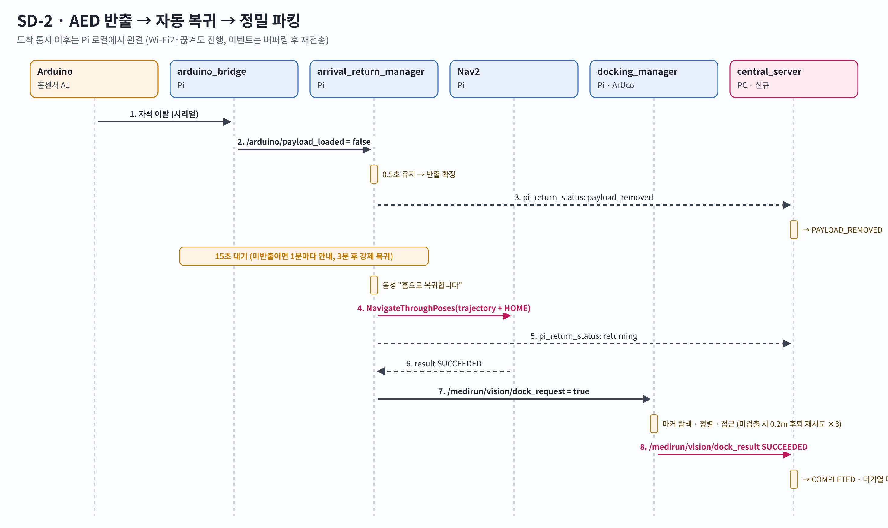
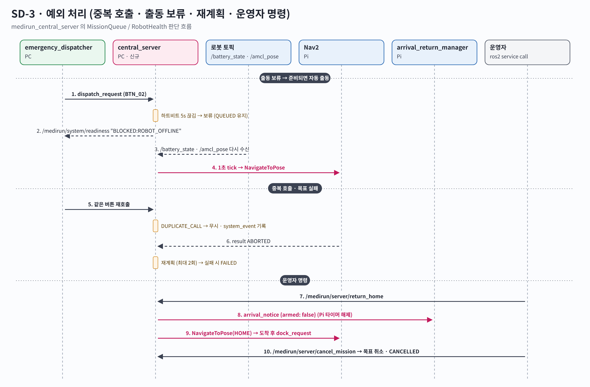

<div align="center">


# AURIX MediRun · 지하철 역사 AED 배송 보조 로봇

### 팀 AURIX · ROS 2 자율주행 로봇 프로젝트

</div>

> **SOS 버튼이 눌린 곳까지 AED를 로봇이 대신 운반합니다.**

TurtleBot3 Burger · AED 트레일러 · ROS 2 Humble · Nav2 · Arduino · Qt6 · PostgreSQL 로 만든 이동형 응급 보조 로봇입니다.
목격자는 환자 곁에 남고, 로봇이 AED를 가져온 뒤 스스로 돌아가 주차합니다.

| 로봇 v1 주행 | 로봇 v2 주행 | 관제 대시보드 |
| :--: | :--: | :--: |
|  |  |  |
| [▶ 전체 영상](https://youtu.be/2j3xnAyrCw8) | [▶ 전체 영상](https://youtu.be/Zs3RCvMrCqs) | [▶ 전체 영상](https://youtu.be/OLHDFCh1oA8) |

---

## 1. 팀 구성 및 역할

| 담당자 | 담당 파트 | 주요 기여 |
| :---: | :---: | --- |
| 도희정 | DB · 대시보드<br>복귀 흐름 | DB 1차 설계(공동)·로그인·로봇 등록, 대시보드 재구성·원격 제어·웨이포인트 관리, 미션 디스패치와 Pi 로컬 복귀(`arrival_return_manager`), ESP32 콜버튼 펌웨어 |
| 최치언 | 하드웨어<br>관제 · 주행 안전 | 로봇·AED 트레일러 제작과 Arduino 센서 보드, DB 1차 설계(공동), 실시간·미션 관제·SLAM 페이지, 초음파 안전정지·Nav2 튜닝, ArUco 전면주차, 정확도 시험 |

> 설계서(00~06)는 함께 작성했습니다. 담당 내용은 `git log`의 작성자별 커밋을 기준으로 정리했습니다.

## 2. 프로젝트 주제

| 항목 | 내용 |
| :-- | :-- |
| 적용 대상 | 지하철 역사 대합실·승강장 (가상 A역 시연) |
| 운용 형태 | 단일 로봇 자율 주행, 도착 이후 반출·복귀·도킹은 로봇이 단독 처리 |
| 호출 구성 | 고정 SOS 버튼 ↔ 호출 구역 1:1 매핑 |
| 개발 기간 | 4주 (2026.07.20 ~ 08.14) |

> MediRun은 AED 운반과 그 기록만 담당합니다. 환자 상태 판단·응급처치·119 자동 신고는 하지 않습니다.

## 3. 주제 선정 이유

AED를 사람 대신 운반하는 시도는 이미 실제 현장에서 검증되고 있습니다. 스웨덴 예테보리에서는 Everdrone이 구급차 출동과 동시에 드론으로 AED를 보내, 비교 가능한 55건 중 37건(67%)에서 구급차보다 먼저 도착했고 도착 시간을 중앙값 약 3분 앞당겼습니다. 국내 급성심장정지 환자는 2023년 33,586건, 생존율은 8.6%이며, 일반인이 심폐소생술을 시행한 경우 생존율은 13.2%로 미시행(7.8%)보다 높았습니다. 반면 목격자가 직접 AED를 가지러 가야 하는 현재 방식은 인력 · 시간 · 기록 측면의 한계가 뚜렷합니다.

- **현장 인력 이탈**: AED를 가지러 가는 동안 환자 곁이 비지 않도록 운반을 로봇이 대신합니다.
- **초기 대응 시간 단축**: 승강장에서 멀리 떨어진 AED 보관함까지의 왕복 시간을 줄입니다.
- **혼잡한 통행 환경**: 경광 LED와 반복 음성 안내로 혼잡한 역사에서도 주행 경로를 확보합니다.
- **안전한 자율 주행**: 라이다가 보지 못하는 낮은 장애물까지 초음파로 감지해 정지 · 우회합니다.
- **대응 기록 자동화**: 호출 구역 · 시각 · 반출 · 복귀를 `mission_id` 하나로 기록해 사후 검토에 활용합니다.

**최종 목표** — 목격자는 환자 곁에서 응급 대응에 집중하고, 로봇이 AED를 운반 · 복귀하며 시스템이 전 과정을 기록하는 응급 보조 체계를 구현합니다.

<sub>출처: [Schierbeck et al., *The Lancet Digital Health* (2023)](https://news.ki.se/drones-enabled-the-use-of-defibrillators-before-ambulance-arrival) · [질병관리청 급성심장정지조사 (2023)](https://www.kdca.go.kr/injury/biz/injury/damgInfo/heartStopMain.do)</sub>

## 4. 핵심 기능

- **SOS 호출 검증** : 버튼 ID·중복 호출·AED 적재·배터리·위치 추정 상태를 확인하고 출동한다.
- **자율 배송** : Nav2로 주행하고 LiDAR·초음파로 장애물을 피한다.
- **반출 감지** : 홀센서 자석 이탈이 0.5초 유지되면 반출로 확정한다.
- **자동 복귀** : 반출 15초 후, 또는 3분 미반출 시 홈으로 돌아간다.
- **정밀 파킹** : ArUco 마커로 좌우 3cm·각도 5° 이내에 주차한다.
- **관제 · 기록** : Qt 대시보드로 관제하고 전 과정을 PostgreSQL에 남긴다.

## 5. 사용자 요구사항 (User Requirements)

| ID | 사용자 요구사항 |
| :-- | :-- |
| UR-001 | 물리 버튼으로 해당 구역에 로봇을 요청할 수 있어야 한다. |
| UR-002 | 버튼 입력 시 구역·좌표·시각이 기록되어야 한다. |
| UR-003 | 로봇이 호출 구역에 10cm 이내로 도착해야 한다. |
| UR-004 | 출발·도착·정지를 음성과 LED로 알 수 있어야 한다. |
| UR-005 | 주행 중 "비켜주세요" 안내를 5초마다 반복해야 한다. |
| UR-006 | 주행 중 빨강↔주황 경광 표시로 멀리서도 식별되어야 한다. |
| UR-007 | 도착 후 3초 이내에 119 신고 안내를 들을 수 있어야 한다. |
| UR-008 | AED가 실려 있지 않으면 출동을 거부해야 한다. |
| UR-009 | AED를 꺼내면 15초 뒤 로봇이 스스로 돌아가야 한다. |
| UR-010 | 지도·위치·배터리·미션·센서·연결 상태를 실시간으로 볼 수 있어야 한다. |
| UR-011 | 권한에 맞는 화면과 기능만 사용할 수 있어야 한다. |
| UR-012 | 위급 시 대시보드에서 즉시 정지시킬 수 있어야 한다. |
| UR-013 | 정지 원인이 사라지면 3초 확인 후 자동 재출발해야 한다. |
| UR-014 | 라이다가 못 보는 15cm 이내 낮은 장애물에서 정지·우회해야 한다. |
| UR-015 | 주행 중 새 호출을 확인·보류·취소할 수 있어야 한다. |
| UR-016 | 이동 실패 시 복귀 여부와 원인을 확인할 수 있어야 한다. |
| UR-017 | 배터리 20% 미만이면 임무보다 복귀를 우선해야 한다. |
| UR-018 | 호출부터 복귀까지 이력을 `mission_id`로 조회할 수 있어야 한다. |
| UR-019 | Wi-Fi가 끊겨도 주행 기록이 로봇에 남아야 한다. |
| UR-020 | 연결이 끊기면 3초마다 재접속하고 밀린 기록을 올려야 한다. |
| UR-021 | 로봇 저장 공간이 포화되지 않도록 기록을 정리해야 한다. |
| UR-022 | 대시보드 실행 시 2.5초 내 스플래시 후 로그인 화면이 떠야 한다. |
| UR-023 | 복귀 후 도킹 위치에 좌우 3cm·각도 5° 이내로 주차해야 한다. |
| UR-024 | 코드 수정 없이 YAML로 버튼·좌표를 바꿀 수 있어야 한다. |
| UR-025 | 전원만 넣으면 전체 시스템이 자동 기동해야 한다. |
| UR-026 | 시연·복구 시 로봇을 원격 조작할 수 있어야 한다. |

## 6. 시스템 요구사항 (System Requirements)

| ID | 기능 | 요구사항 |
| :-- | :-- | :-- |
| SR-F-001 | 호출 수신 | `button_id`와 시각을 받아 등록 여부를 검증한다. |
| SR-F-002 | 목적지 변환 | 등록된 이름을 map 기준 Pose로 변환한다. |
| SR-F-003 | Nav2 주행 | Nav2 목표를 보내고 결과·피드백을 처리한다. |
| SR-F-004 | 호출 대기열 | 진행 중 미션이 있으면 신규 호출을 `QUEUED`로 둔다. |
| SR-F-005 | 음성 안내 | 상태별 음성 안내를 로봇 스피커로 출력한다. |
| SR-F-006 | 경고 음성 | `NAVIGATING` 동안 경고 음성을 5초마다 반복한다. |
| SR-F-007 | 경광 LED | 주행 중 LED를 빨강↔주황으로 교대 점멸한다. |
| SR-F-008 | 119 안내 | `ARRIVED` 진입 3초 안에 119 안내를 1회 출력한다. |
| SR-F-009 | 적재 확인 | 홀센서로 AED 적재를 확인하고 미적재 시 거부한다. |
| SR-F-010 | 자동 복귀 | 반출 15초 후 복귀, 미반출이면 1분마다 안내 후 3분에 복귀한다. |
| SR-F-011 | 상태 전달 | 위치·배터리·연결·미션·센서 상태를 화면에 전달한다. |
| SR-F-012 | 권한 | 로그인 역할에 따라 메뉴와 조작을 제한한다. |
| SR-F-013 | 급정지 | 속도 명령을 차단해 0속도를 유지하고 목표는 보관한다. |
| SR-F-014 | 재출발 | 조건 충족을 판정하고 보관된 목표로 재개한다. |
| SR-F-015 | 저상 장애물 | 전방 하단 초음파 임계 거리에서 정지·재계획한다. |
| SR-F-016 | 실패 대응 | 이동 실패 시 홈 복귀를 시도하고, 실패하면 정지·알람한다. |
| SR-F-017 | 배터리 보호 | 20% 미만이면 미션을 중단하고 복귀한다. |
| SR-F-018 | 로컬 기록 | 미션·이벤트·주행 기록을 로봇 DB에 먼저 저장한다. |
| SR-F-019 | 재연결 | 3초마다 재연결하고 미동기 기록을 시간순으로 올린다. |
| SR-F-020 | 기록 정리 | 동기화된 기록과 임시 파일을 하루 단위로 정리한다. |
| SR-F-021 | 스플래시 | 대시보드 기동 시 로고 스플래시를 재생한다. |
| SR-F-022 | 정밀 도킹 | ArUco 마커로 정렬·접근·도킹을 판정한다. |
| SR-F-023 | 자동 실행 | 프로세스 관리자가 전 노드를 부팅 시 기동·재시작한다. |
| SR-F-024 | 경로 주행 | 버튼별 경로(trajectory)를 중간 정지 없이 주행하고 같은 경로로 복귀한다. |

<details>
<summary>성능 · 안전 요구사항 보기</summary>

| ID | 항목 | 기준 |
| :-- | :-- | :-- |
| SR-P-001 | 버튼 응답 | 버튼 입력 → 미션 생성 1초 이내 (20회) |
| SR-P-002 | 도착 오차 | 평균 3cm 이하, 최대 5cm 이하 |
| SR-P-003 | 직진 오차 | 1m 직진 평균 1cm 이하 (10회) |
| SR-P-004 | 회전 오차 | 90°·180° 평균 2° 이하 (각 10회) |
| SR-P-006 | 급정지 | GUI 입력 → 0속도 0.5초 이내 |
| SR-P-008 | 저상 장애물 | 15cm 진입 → 정지 0.3초 이내, 충돌 0건 |
| SR-P-010 | 단절 감지 | heartbeat 차단 → 판정 2초 이내 |
| SR-P-012 | 도킹 정밀도 | 좌우 3cm·각도 5° 이하, 10회 중 8회 성공 |
| SR-P-013 | 반복 신뢰성 | 전체 시나리오 10회 중 8회 성공 (연속 3회 포함) |
| SR-S-001 | 속도 제한 | 최대 0.05m/s · 0.7rad/s (도킹 최종 접근 0.03m/s) |
| SR-S-004 | 우선순위 | 비상정지 > 배터리 복귀 > 자율주행 > 원격 제어 |
| SR-S-006 | 미션 보존 | 급정지는 목표를 취소하지 않고 속도만 차단 |

</details>

## 7. 시스템 아키텍처

### 하드웨어 아키텍처


### 소프트웨어 아키텍처


## 8. 하드웨어 구성

| 구분 | 구성 |
| :-- | :-- |
| 주행 플랫폼 | TurtleBot3 Burger (OpenCR 1.0, Dynamixel XL430 ×2) |
| 메인 컴퓨터 | Raspberry Pi 4 · Ubuntu 22.04 · ROS 2 Humble |
| 센서 | LDS-02 LiDAR, IMX219 카메라 |
| 센서 보드 | Arduino — 초음파 전·후방, 홀센서, RGB 경광 LED |
| AED 트레일러 | 직접 제작, AED 수납함 + 자석, 하부 볼 캐스터(v2) |
| 호출 장치 | ESP32 Wi-Fi 콜버튼 (MQTT) |

<table>
  <tr>
    <td align="center" width="33%"></td>
    <td align="center" width="33%"></td>
    <td align="center" width="33%"></td>
  </tr>
  <tr>
    <td align="center">v0 · 박스 트레일러 시험</td>
    <td align="center">v1 · 첫 번째 제작</td>
    <td align="center">v2 · 볼 캐스터 보강</td>
  </tr>
</table>


> 유선 SOS 버튼 입력(A1~A3)은 A1을 홀센서가 쓰고 있어 비활성입니다. 호출은 ESP32 콜버튼으로만 받습니다.

## 9. 운영 시나리오

### Scenario #1 - SOS 호출과 AED 배송

1. 목격자 한 명은 119에 신고하고, 다른 한 명은 가장 가까운 SOS 버튼을 누른다.
2. ESP32가 `BTN_01`을 MQTT로 보내고, `emergency_dispatcher`가 출동 조건을 확인한다.
3. 로봇이 경광 LED와 "비켜주세요" 안내를 내며 호출 구역으로 주행한다.
4. 도착하면 AED 도착과 119 신고 안내를 출력한다.

### Scenario #2 - AED 반출과 자동 복귀

1. 사람이 수납함에서 AED를 꺼내면 홀센서가 0.5초 뒤 반출을 확정한다.
2. 15초 후 "홈으로 복귀합니다" 안내와 함께 경로를 따라 돌아간다.
3. 도킹 대기점에서 ArUco 마커를 찾아 정밀 주차한다.
4. 전 과정이 `mission_id` 기준으로 기록되고 다음 호출을 기다린다.

### Scenario #3 - 주행 중 예외 상황

1. 주행 중 새 호출이 오면 대기열에 넣고 현재 미션을 먼저 끝낸다.
2. 목표 도달에 실패하면 최대 2회 다시 계획하고, 실패하면 `FAILED`로 기록한다.
3. 배터리 30% 미만이면 신규 출동을 거부하고 20% 미만이면 바로 복귀한다.
4. AED가 실려 있지 않으면 출동을 거부하고 경고를 낸다.

### Scenario #4 - 미반출과 Wi-Fi 단절

1. AED를 꺼내지 않으면 1분마다 반출을 안내한다.
2. 3분이 지나면 AED를 실은 채 홈으로 돌아간다.
3. 도착 이후 단계는 Pi가 단독으로 처리해 Wi-Fi가 끊겨도 멈추지 않는다.
4. 끊긴 동안의 이벤트는 저장해 두었다가 다시 연결되면 순서대로 올린다.

<table>
  <tr>
    <td align="center" width="25%"></td>
    <td align="center" width="25%"></td>
    <td align="center" width="25%"></td>
    <td align="center" width="25%"></td>
  </tr>
  <tr>
    <td align="center">① 콜버튼 호출</td>
    <td align="center">② 자율 주행</td>
    <td align="center">③ AED 반출</td>
    <td align="center">④ 정밀 파킹</td>
  </tr>
</table>

## 10. 시퀀스 다이어그램

각 시나리오에서 노드 사이에 오가는 메시지 순서입니다.

### Scenario #1 - SOS 호출과 AED 배송


### Scenario #2 - AED 반출과 자동 복귀



### Scenario #3 - 주행 중 예외 상황



## 11. 중앙 서버 (ROS 2)

출동 판단을 대시보드 밖으로 빼서, PC의 ROS 2 노드 `medirun_central_server`가 맡도록 했습니다.

- **호출 대기열** : 같은 버튼 중복 호출을 막고, 주행 중 호출은 순서대로 처리한다.
- **출동 판단** : 배터리·위치·AED 적재·Nav2 상태로 출동 가능 여부를 정한다.
- **도착 통지** : 도착하면 Pi에 복귀 정보를 넘기고, 반출·복귀는 Pi가 처리한다.
- **기록** : 미션 상태 변화를 JSONL과 PostgreSQL에 남긴다.
- **운영 명령** : `get_status` · `cancel_mission` · `return_home` 서비스를 제공한다.

| 실행 모드 | 설명 |
| :-- | :-- |
| `active` | 대시보드 없이 서버가 출동을 맡는다. 대시보드와 동시에 쓰지 않는다. |
| `monitor` | 대시보드가 출동하고, 서버는 상태 집계와 기록만 한다. |


> 시험 33건을 통과했습니다. 실제 로봇과의 연동 주행 시험은 아직 진행하지 않았습니다.

## 12. 구현 결과

| 시험 | 항목 | 결과 | 기준 | 판정 |
| :-- | :-- | :-- | :-- | :-- |
| T-00 | 90° 회전 10회 | 평균 오차 0.13° | 2° 이하 | 충족 |
| T-01 | 0.45m 직진 10회 | 평균 오차 0.2cm | 1cm 이하 | 충족 |

- **시험 원본** : [`docs/tests/`](docs/tests)
- **트러블슈팅** : [`docs/troubleshooting/`](docs/troubleshooting) (통신 · DB · GUI · 하드웨어 · 주행 · SLAM)
- **자동 시험** : `medirun_mission` 115건, `medirun_server` 33건 통과

## 13. 소스 구성

| 경로 | 역할 |
| :-- | :-- |
| [`src/medirun_server/`](src/medirun_server) | 중앙 서버 — 호출 대기열·출동·상태 집계·기록 |
| [`src/medirun_mission/`](src/medirun_mission) | 출동 검증·미션 관리·Pi 로컬 복귀·안전 관리 |
| [`src/medirun_sensor/`](src/medirun_sensor) | Arduino 시리얼 브리지·MQTT 브리지 |
| [`src/medirun_vision/`](src/medirun_vision) | ArUco 검출·정밀 도킹 |
| [`src/medirun_gui/`](src/medirun_gui) | Qt6 관제 대시보드 |
| [`src/medirun_bringup/`](src/medirun_bringup) | Pi·PC·콜존 실행 launch |
| [`firmware/`](firmware) | Arduino · ESP32 펌웨어 |
| [`db/`](db) | PostgreSQL 스키마 · 마이그레이션 |
| [`docs/`](docs) | 설계서 00~06 · 시험 · 트러블슈팅 · 이미지 |

## 14. 프로젝트 기술 스택

| 구분 | 사용 기술 |
| :-- | :-- |
| Robot / Hardware | TurtleBot3 Burger, Raspberry Pi 4, OpenCR 1.0, LDS-02, IMX219, Arduino, ESP32 |
| Robot Middleware | ROS 2 Humble, Nav2, AMCL, Cartographer, CycloneDDS |
| Vision | OpenCV ArUco |
| Server / Data | Python, PostgreSQL 16, Docker Compose, MQTT(mosquitto) |
| GUI | Qt6 (C++) |
| 운영 · 협업 | PM2 · systemd 자동 실행, Git 훅 기반 커밋 규칙, GitHub |

## 15. 설치와 실행

```bash
git clone https://github.com/postwo/AURIX_MEDIRUN-PROJECT1.git
cd AURIX_MEDIRUN-PROJECT1
source /opt/ros/humble/setup.bash
colcon build --symlink-install --packages-skip medirun_msgs
source install/setup.bash
```

| 장비 | 실행 명령 |
| :-- | :-- |
| DB | `cp .env.example .env` 후 `docker compose up -d` |
| 로봇 (Pi) | `ros2 launch medirun_bringup pi_bringup.launch.py` |
| 관제 PC (대시보드) | `./scripts/run.sh` |
| 관제 PC (중앙 서버) | `./scripts/run_server.sh` (대시보드와 함께면 `MEDIRUN_SERVER_MODE=monitor`) |

자세한 절차는 [개발 환경 · 빌드 · 실행 가이드](docs/WORKSPACE_GUIDE.md)를 참고하세요.

## 16. 문서

| 문서 | 내용 |
| :-- | :-- |
| [00 프로젝트 개요서](docs/AURIX_MediRun_00_프로젝트_개요서.pdf) | 추진 배경 · 시스템 구성 · 성공 기준 |
| [01 서비스 시나리오서](docs/AURIX_MediRun_01_서비스_시나리오서.pdf) | 정상 · 예외 시나리오 (S-01 ~ S-12) |
| [02 요구사항 · 설계 · 시험](docs/AURIX_MediRun_02_요구사항_설계_시험인수_위험관리.pdf) | UR · SR · 시험 계획 · 위험 관리 |
| [03 GUI · HMI 설계](docs/AURIX_MediRun_03_GUI_HMI_설계_Qt_CPP_최종완료본.pdf) | Qt 대시보드 설계 |
| [04 ROS 2 소프트웨어 설계](docs/AURIX_MediRun_04_ROS2_소프트웨어_설계.pdf) | 노드 · 토픽 · 상태 머신 |
| [05 시스템 아키텍처](docs/AURIX_MediRun_05_시스템_아키텍처_구조도.pdf) | 데이터 흐름 · 안전 제어 |
| [06 개발 규칙서](docs/AURIX_MediRun_06_개발_규칙서.pdf) | Git · 네이밍 규칙 |

---

**팀 AURIX**
