<div align="center">


# AURIX MediRun

**지하철 역사 AED 배송 보조 로봇**

SOS 버튼이 눌린 구역까지 AED를 자율 주행으로 운반하고, 반출 후 스스로 복귀·파킹하며, 전 과정을 로컬 DB에 기록합니다.


</div>

<br/>

## 📌 프로젝트 소개

환자가 쓰러졌을 때 목격자가 AED를 가지러 자리를 비우면 환자 곁이 비게 되고, 왕복 시간이 초기 대응 시간을 잠식합니다. **MediRun은 AED 운반을 로봇이 대신해서, 사람이 환자 곁에 남아 응급 대응에 집중할 수 있게 하는 이동형 보조 로봇**입니다.

| 항목 | 내용 |
| :-- | :-- |
| 적용 대상 | 지하철 역사 대합실·승강장 (가상 A역 기준 시연) |
| 운용 형태 | 단일 로봇 자율 주행, 로봇 내부 완결형 (중앙 서버 미사용) |
| 호출 구성 | 고정 SOS 버튼 3개 ↔ 최종 목적지 3개, 1:1 매핑 |
| 플랫폼 | TurtleBot3 Burger + 직접 제작한 AED 트레일러, Raspberry Pi 4 |
| 개발 기간 | 4주 (2026.07.20 ~ 08.14) |
| 팀원 | 도희정, 최치언 |

> **수행 범위 제한**: MediRun은 AED 운반과 그 기록만 담당합니다. 환자 상태 판단, 응급처치 판단, 119 자동 신고는 하지 않으며 119 신고는 현장의 사람이 직접 합니다.

<br/>

## 🎯 핵심 기능

| 기능 | 내용 |
| :-- | :-- |
| SOS 호출 검증 | 버튼 ID를 웨이포인트에 매핑하고, 중복 호출·AED 적재·배터리·AMCL·Nav2 상태를 검사한 뒤 호출 위치와 시각을 기록 |
| 자율 AED 배송 | Nav2 자율 주행, LiDAR·초음파 장애물 회피, 경광 LED와 5초 주기 음성 안내로 경로 확보 |
| 반출 감지 | 홀센서 자석 이탈이 0.5초 이상 유지되면 AED 반출로 확정 |
| 자동 복귀 | 반출 확정 후 15초 대기, 또는 3분 미반출 시 AED를 실은 채 홈 웨이포인트로 복귀 |
| 정밀 파킹 | 도킹 대기점에서 ArUco 마커를 탐색·정렬해 3cm 이내로 파킹 |
| 관제 대시보드 | Qt(C++) 역할별 화면, 실시간 모니터링, 원격 수동 제어, SLAM 맵핑 |
| 운용 기록 | 호출·주행·반출·복귀·오류를 `mission_id` 기준으로 로컬 PostgreSQL에 저장 |

<br/>

## 🏗 시스템 아키텍처

<div align="center">

</div>

- **현장 입력**: 역사 안 ESP32 콜버튼이 MQTT로 호출을 보내면 MQTT 브리지 노드가 버튼 ID를 출동 요청으로 바꿔 ROS 2 토픽으로 전달합니다.
- **로봇(Raspberry Pi 4 + TurtleBot3)**: 아두이노 센서(초음파·홀센서·LED)를 USB Serial로 받고, Nav2·AMCL이 주행하며, 초음파 안전 게이트와 `safety_manager`가 모든 속도 명령을 마지막으로 검사한 뒤 `/cmd_vel`을 내보냅니다.
- **관제(PC)**: Qt GUI가 미션·SLAM 상태를 관제하고, 호출·미션·녹화 기록은 PostgreSQL에 남깁니다.
- **로컬 독립성**: Wi-Fi나 대시보드가 끊겨도 주행·안전 판단·복귀·기록은 로봇 내부에서 계속 수행하고, 대시보드는 3초 주기로 재연결합니다.

### 노드 책임 분리

| 계층 | 노드 | 역할 |
| :-- | :-- | :-- |
| 서비스 응용 | `emergency_dispatcher` | 버튼 ID·안전 조건 검증, 미션 요청 생성 (Nav2를 직접 제어하지 않음) |
| | `waypoint_manager` | YAML 목적지·경로 조회와 Pose 검증 |
| | `mission_manager` | 상태 전이, Nav2 액션, 재시도·복귀 관리 |
| 안전·적재 | `safety_manager` | 모든 속도 명령보다 높은 우선순위로 최종 검사, 위험 시 0속도 |
| | `payload_monitor` | 홀센서 기반 AED 적재·반출 확정 |
| 주행·도킹 | Nav2 · AMCL · TF | 경로 계획·재계획, map 기준 위치 추정 |
| | `docking_manager` | ArUco 정렬·접근·도킹 재시도 |
| 입출력 | `arduino_bridge` | 버튼·초음파·홀센서·LED 시리얼 연결 |
| 기록·실행 | `event_logger` · PostgreSQL · PM2 | 미션 ID 기준 이벤트 저장, 부팅 시 자동 실행·장애 시 재시작 |

<br/>

## 🔄 미션 흐름과 안전 제어

```
IDLE → VALIDATING → DISPATCHED → NAVIGATING → ARRIVED → PAYLOAD_REMOVED → RETURNING_HOME → DOCKING → DOCKED → IDLE
```

1. **SOS 호출** — 버튼 입력은 300ms 디바운스를 거쳐 버튼 ID로 변환됩니다.
2. **출동 조건 검증** — 배터리·AED 적재·AMCL·Nav2 상태를 확인하고 목적지를 확정합니다.
3. **자율 배송** — Nav2로 주행하며 경광 LED와 음성으로 길을 확보합니다.
4. **도착·반출** — 목표점 10cm 이내에 정지해 도착을 안내하고, 홀센서가 반출을 확정합니다.
5. **복귀·기록** — 홈으로 복귀해 ArUco로 정밀 파킹하고 전 과정을 저장합니다.

**판단 우선순위: 안전정지 › 배터리 보호 › AED 배송 › 자동 복귀 › 원격 제어**

| 상황 | 처리 |
| :-- | :-- |
| GUI 비상정지 | 즉시 0속도, 안전 조건을 충족하기 전까지 재출발 금지 |
| 낮은 장애물 | 초음파 감지 시 감속·정지 후 Nav2 재계획 |
| 주행 중 중복 호출 | 기존 미션 유지, 신규 호출은 대기열에 등록 |
| 목표 도달 실패 | 비용지도 초기화 후 최대 2회 재계획, 실패 시 기록 |
| 배터리 부족 | 30% 미만 신규 미션 거부, 20% 미만 즉시 복귀, 10% 미만 안전정지 |
| ArUco 미검출 | 0.2m 후퇴 후 재탐색, 최대 3회 재시도 |
| AMCL 위치 유실 | 현재 위치 정지, 신규 목표 차단, 관리자 확인 요청 |
| AED 미적재 호출 | 미션 거부, 경고 음성·LED·대시보드 경고 |

> 위 수치는 설계서 기준이며, 초음파 정지 거리처럼 시험 중 조정된 값은 launch 파라미터에서 관리합니다.

<br/>

## 🤖 로봇 하드웨어 변경 (v1 → v2)

### v1

<table>
  <tr>
    <td width="50%">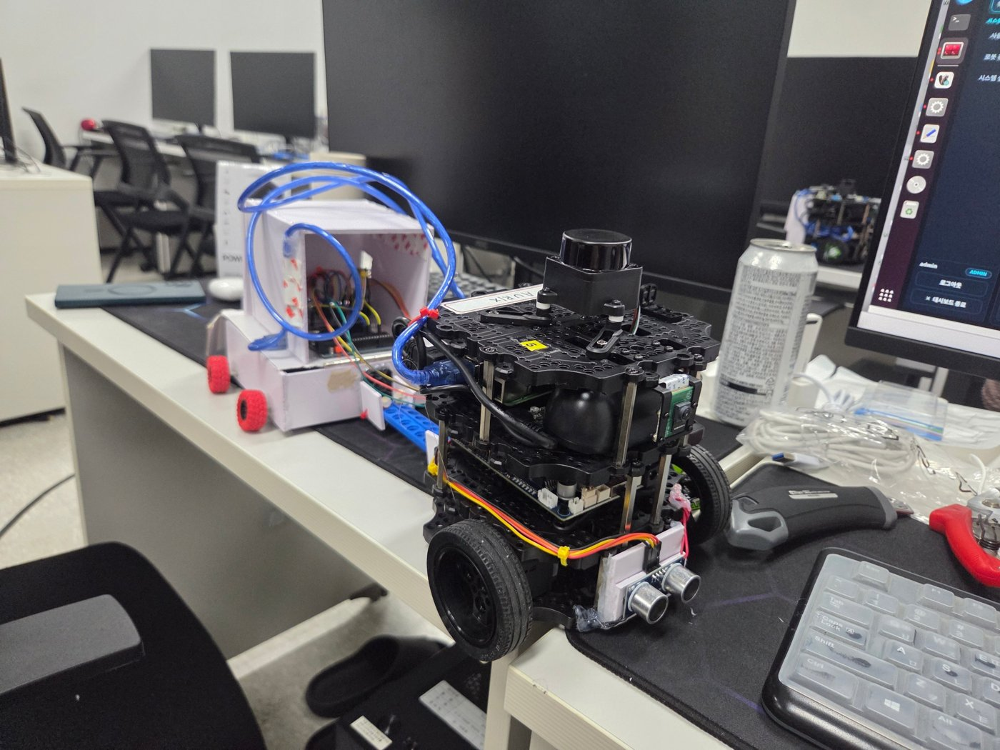</td>
    <td width="50%"></td>
  </tr>
</table>

### v2

<table>
  <tr>
    <td width="50%">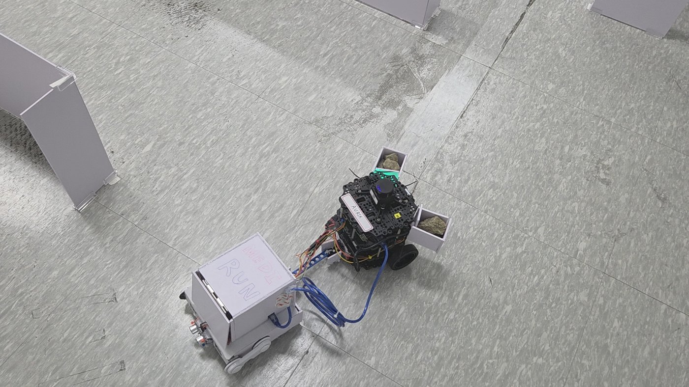</td>
    <td width="50%">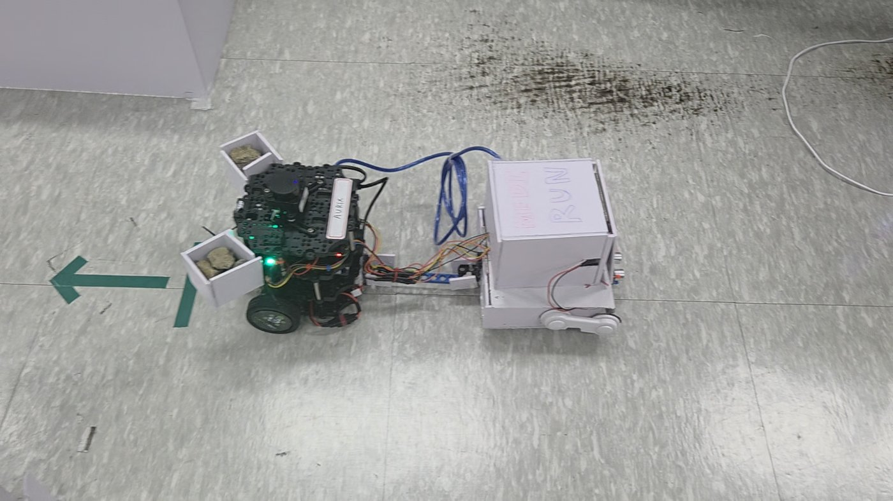</td>
  </tr>
</table>

<p align="center">
  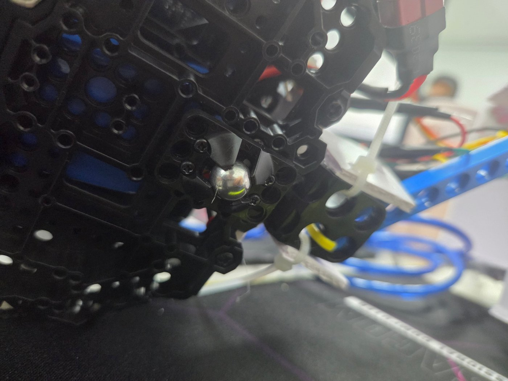
</p>

주행 영상: [하드웨어 수정 주행 영상](Video/하드웨어%20수정%20주행%20영상.mp4)

<br/>

## 🖥 관제 대시보드 (Qt / C++)

관제사가 로봇 상태와 미션을 한 화면에서 확인하고, 필요하면 비상정지·미션 취소·홈 복귀·원격 조종을 내릴 수 있는 Qt(C++) 대시보드입니다. 대시보드가 끊겨도 자율 미션은 로봇 안에서 계속 수행됩니다.

<div align="center">
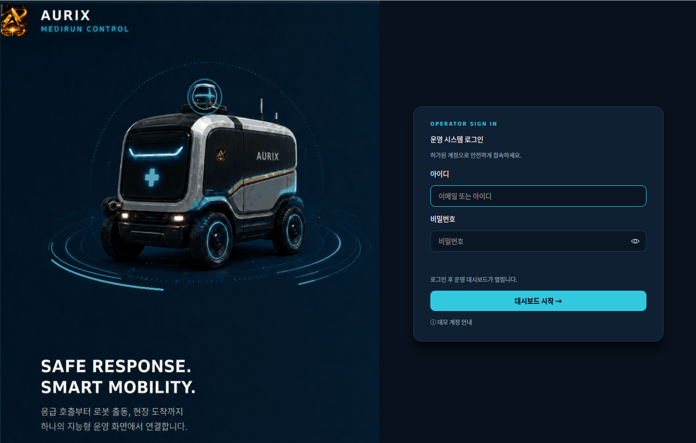
</div>

### 관제

| 운영 현황 | 실시간 관제 |
| :--: | :--: |
| 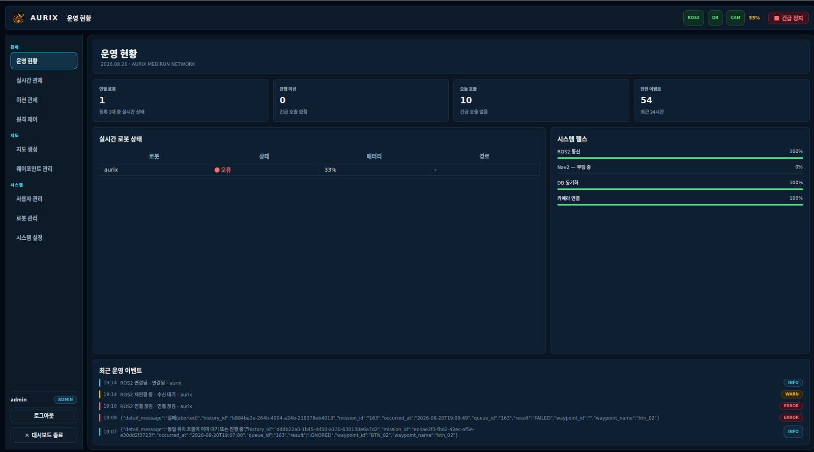 | 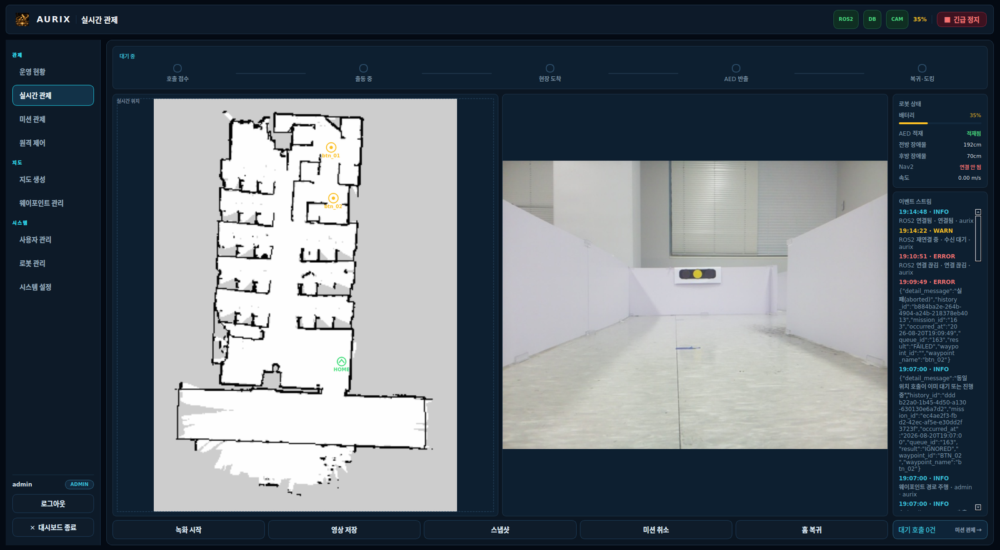 |
| 연결 로봇·진행 미션·오늘 호출·안전 이벤트 요약, 시스템 헬스(ROS 2·Nav2·DB·카메라) | 지도 위 로봇 위치, 카메라 영상, 배터리·AED 적재·전후방 장애물 상태, 녹화·스냅샷·미션 취소·홈 복귀 |

| 미션 관제 | 원격 제어 |
| :--: | :--: |
| 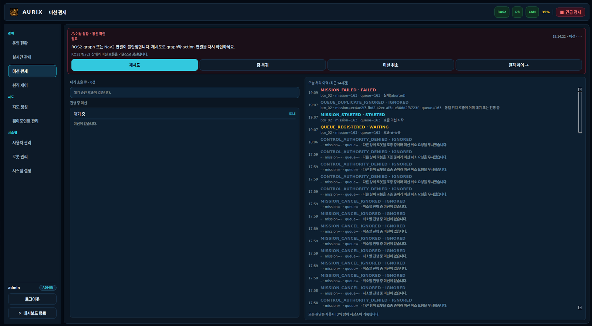 | 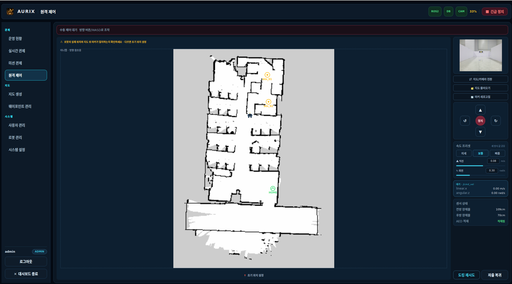 |
| 대기 호출 큐, 진행 중 미션, 24시간 처리 이력, 이상 상황 알림과 재시도·홈 복귀·미션 취소 | 방향 버튼·WASD 수동 조종, 속도 프리셋, 센서 상태, 도킹 재시도·자율 복귀 |

### 지도 · 시스템

| 웨이포인트 관리 | 이벤트 관리 |
| :--: | :--: |
| 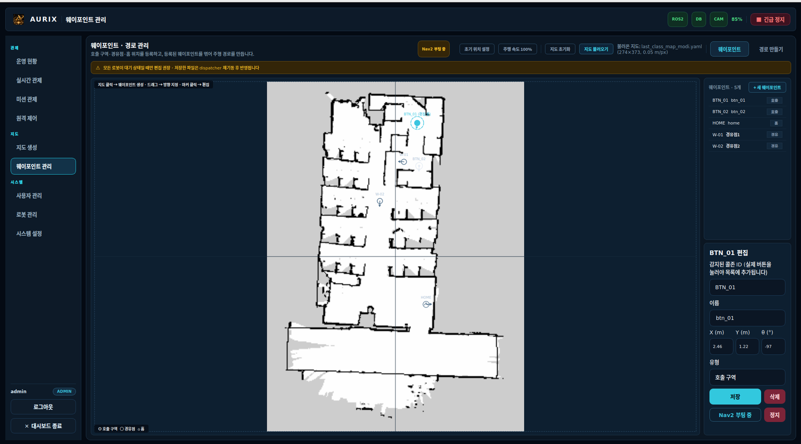 | 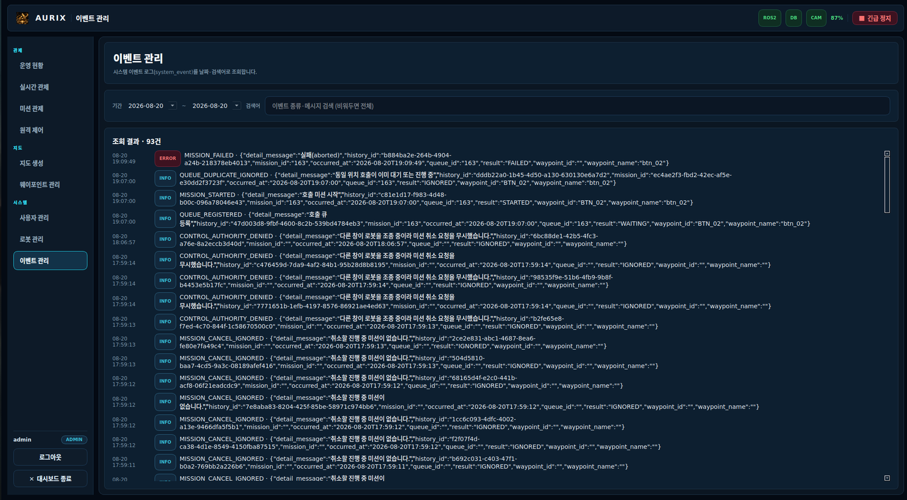 |
| 지도 위에서 호출 구역·경유점·홈 위치를 등록하고 좌표·방향을 편집 | `system_event` 로그를 날짜·검색어로 조회 |

| 로봇 관리 | 사용자 관리 |
| :--: | :--: |
| 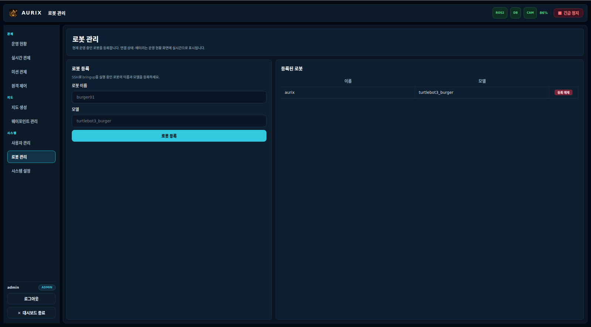 | 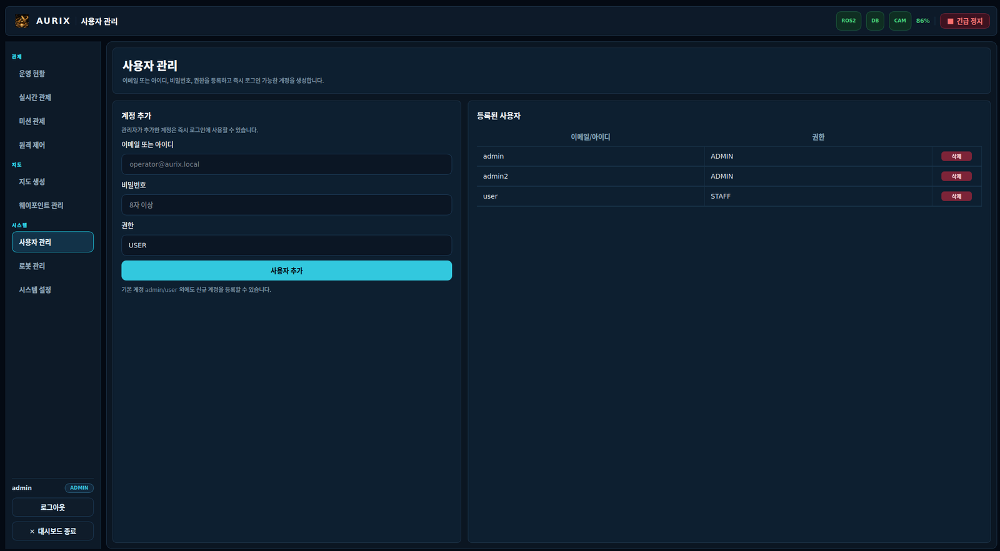 |
| 운영 중인 로봇 이름과 모델 등록 | 계정 추가·삭제와 권한(ADMIN/STAFF/USER) 관리 |

운영 영상: [대시보드 운영 영상](Video/대시보드%20운영%20영상2026-08-24%2012-01-20%20%28online-video-cutter.com%29.mp4)

<br/>

## 🧪 시험 결과

| 시험 ID | 항목 | 결과(절대평균오차) | 기준 | 판정 |
| :-- | :-- | :-- | :-- | :-- |
| T-00 | 회전 정확도 (90°, 10회) | 0.13° | ≤ 2° | 충족 |
| T-01 | 직진 정확도 (0.45m, 10회) | 0.2cm | ≤ 1cm | 충족 |

**성공 판정 기준**: 버튼당 3회 반복 매핑 성공 · 일반 목적지 오차 10cm 이내 · 도킹 오차 3cm 이내 · 전체 시나리오 E2E 10회 중 8회 이상 성공(연속 3회 포함)

<br/>

## 🛠 기술 스택

| 영역 | 스택 |
| :-- | :-- |
| 로봇 | TurtleBot3 Burger, Raspberry Pi 4, 2D LiDAR, 카메라(ArUco), 초음파·홀센서, ESP32/Arduino |
| 소프트웨어 | ROS 2 Humble, Nav2, AMCL, SLAM(Cartographer·SLAM Toolbox), Python 3.10, C++ |
| 관제 | Qt6 (C++), RViz2 |
| 데이터 | PostgreSQL 16 (Docker Compose), `event_logger` |
| 통신 | USB Serial, MQTT, ROS 2 DDS (CycloneDDS), UDP 영상 전송 |
| 운영 | PM2 + systemd 자동 실행, Git 훅 기반 커밋 규칙 |

<br/>

## 📚 문서

| 문서 | 내용 |
| :-- | :-- |
| [00 프로젝트 개요서](docs/AURIX_MediRun_00_프로젝트_개요서.pdf) | 추진 배경, 시스템 구성, 서비스 흐름, 운영 원칙, 성공 기준 |
| [01 서비스 시나리오서](docs/AURIX_MediRun_01_서비스_시나리오서.pdf) | 정상·예외 시나리오(S-01~S-12), 상태 전이 |
| [02 요구사항·설계·시험·인수·위험관리](docs/AURIX_MediRun_02_요구사항_설계_시험인수_위험관리.pdf) | 사용자·시스템 요구사항, Nav2·안전·도킹 설계, 시험 계획 |
| [03 GUI·HMI 설계](docs/AURIX_MediRun_03_GUI_HMI_설계_Qt_CPP_최종완료본.pdf) | Qt(C++) 대시보드 설계 |
| [04 ROS 2 소프트웨어 설계](docs/AURIX_MediRun_04_ROS2_소프트웨어_설계.pdf) | 노드·토픽·서비스·액션, 상태 머신, 로그 설계 |
| [05 시스템 아키텍처 구조도](docs/AURIX_MediRun_05_시스템_아키텍처_구조도.pdf) | 데이터 흐름, 안전 제어, 확장성 |
| [06 개발 규칙서](docs/AURIX_MediRun_06_개발_규칙서.pdf) | Git 작업 규칙, 네이밍·구조 규칙 |
| [개발 환경·빌드·실행 가이드](docs/WORKSPACE_GUIDE.md) | 워크스페이스 구성, 빌드·실행 절차, 시험 방법 |
| [COMMIT_RULES](COMMIT_RULES.md) · [CONVENTIONS](CONVENTIONS.md) | 브랜치·커밋 규칙, 네이밍·구조 컨벤션 |

<br/>

## 🚀 빠른 시작

```bash
./scripts/setup-git-hooks.sh        # Git 훅 활성화 (clone 직후 1회)
source /opt/ros/humble/setup.bash
colcon build --symlink-install --packages-skip medirun_msgs
source install/setup.bash
./scripts/run.sh                    # Nav2 + 대시보드 기동
```

DB 설정, Pi 쪽 실행, 카메라, 시험 실행 등 자세한 절차는 [개발 환경·빌드·실행 가이드](docs/WORKSPACE_GUIDE.md)를 참고하세요.
